# UT4: Funciones y módulos

## Introducción

Hasta ahora hemos creado programas en los que todas las instrucciones se encuentran, normalmente, dentro de un único archivo. Esto funciona bien mientras los programas son pequeños, pero a medida que crecen empiezan a aparecer algunos problemas:

- repetimos instrucciones;
- el archivo principal se hace cada vez más largo;
- cuesta localizar cada parte del programa;
- resulta más difícil corregir errores;
- reutilizar código obliga a copiarlo y pegarlo.

En esta unidad aprenderemos a **organizar el código en partes más pequeñas y reutilizables**.

Primero utilizaremos **funciones** para dividir un programa en tareas concretas. Después veremos cómo podemos guardar funciones relacionadas en archivos separados llamados **módulos**. Finalmente introduciremos el concepto de **paquete**, que permite agrupar varios módulos.

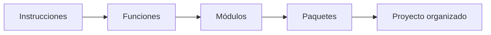

!!! info "Idea principal"
    Programar no consiste únicamente en conseguir que el programa funcione. También debemos intentar que el código sea **fácil de leer, modificar, probar y reutilizar**.

### ¿Qué aprenderemos?

Al finalizar esta unidad deberías ser capaz de:

- crear y utilizar funciones;
- utilizar parámetros y valores de retorno;
- diferenciar entre `print()` y `return`;
- comprender el ámbito de las variables;
- dividir un problema grande en funciones pequeñas;
- crear módulos propios;
- importar módulos de diferentes formas;
- utilizar módulos de la biblioteca estándar de Python;
- diferenciar entre módulos propios, módulos estándar y librerías externas;
- comprender la diferencia entre un módulo y un paquete;
- organizar un programa sencillo en varios archivos.

---

# 1. Funciones

## 1.1. ¿Por qué necesitamos funciones?

Observa este programa:

```python
nombre1 = "Laura"
nota1 = 7
print(f"{nombre1}: {nota1}")

nombre2 = "Carlos"
nota2 = 5
print(f"{nombre2}: {nota2}")

nombre3 = "Marta"
nota3 = 9
print(f"{nombre3}: {nota3}")
```

El programa funciona, pero estamos repitiendo prácticamente las mismas instrucciones.

Podemos mejorar el código creando una función:

```python
def mostrar_nota(nombre, nota):
    print(f"{nombre}: {nota}")


mostrar_nota("Laura", 7)
mostrar_nota("Carlos", 5)
mostrar_nota("Marta", 9)
```

Ahora la acción de mostrar una nota se ha definido **una sola vez** y podemos utilizarla tantas veces como necesitemos.

!!! tip "Regla práctica"
    Si detectas que estás escribiendo varias veces instrucciones muy parecidas, probablemente exista una buena oportunidad para crear una función.

---

## 1.2. ¿Qué es una función?

Una **función** es un bloque de código con un nombre que realiza una tarea concreta y que podemos ejecutar cuando lo necesitemos.

Una función puede:

- recibir datos;
- procesarlos;
- ejecutar instrucciones;
- devolver un resultado.

Podemos imaginar una función como una pequeña máquina:

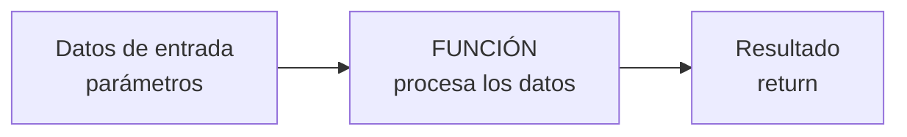

Por ejemplo:

```python
def sumar(a, b):
    resultado = a + b
    return resultado
```

La función recibe dos datos (`a` y `b`), realiza una operación y devuelve el resultado.

---

## 1.3. Definir y llamar una función

Crear una función y utilizarla son dos acciones diferentes.

### Definir una función

Utilizamos la palabra reservada `def`:

```python
def saludar():
    print("Hola")
```

En este momento Python conoce la función, pero todavía **no la ha ejecutado**.

### Llamar a una función

Para ejecutarla escribimos su nombre seguido de paréntesis:

```python
saludar()
```

Resultado:

```text
Hola
```

!!! warning "Definir no es ejecutar"
    Escribir `def saludar():` crea la función.  
    Escribir `saludar()` hace que Python ejecute las instrucciones de esa función.

---

## 1.4. Sintaxis básica

La estructura general de una función es:

```python
def nombre_funcion(parametros):
    instrucciones
    return resultado
```

Ejemplo:

```python
def calcular_doble(numero):
    doble = numero * 2
    return doble
```

### Partes de una función

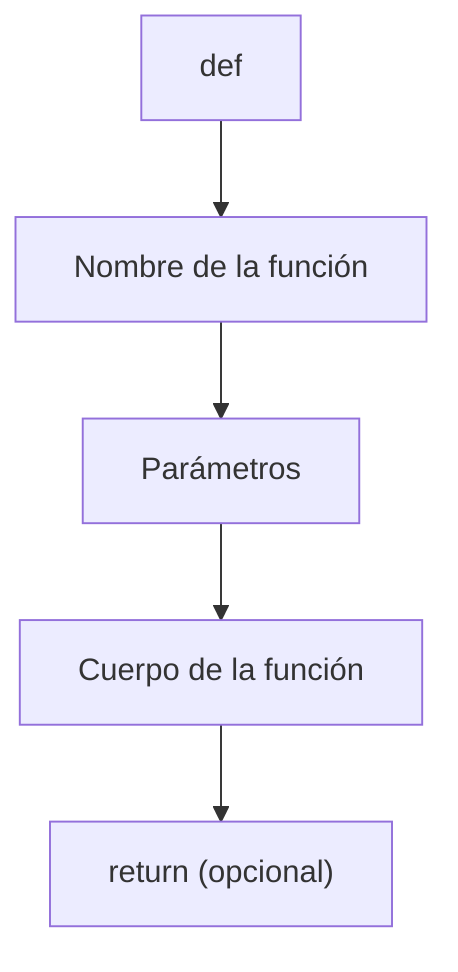

- `def`: indica que vamos a definir una función.
- `nombre_funcion`: nombre que utilizaremos para llamar a la función.
- `parametros`: datos que puede recibir la función.
- `:`: marca el comienzo del bloque.
- cuerpo de la función: instrucciones que se ejecutarán.
- `return`: permite devolver un resultado.

!!! tip "Nombres de funciones"
    Utiliza nombres que indiquen claramente qué hace la función:

    ```python
    calcular_media()
    mostrar_menu()
    validar_contrasena()
    buscar_usuario()
    ```

    Evita nombres poco descriptivos como:

    ```python
    funcion1()
    hacer_cosa()
    proceso()
    ```

---

# 2. Parámetros y argumentos

## 2.1. Funciones sin parámetros

Una función no siempre necesita recibir información.

```python
def mostrar_bienvenida():
    print("Bienvenido al programa")


mostrar_bienvenida()
```

La función realiza siempre la misma acción.

---

## 2.2. Funciones con parámetros

Los **parámetros** son variables que aparecen en la definición de una función y permiten que la función reciba información.

```python
def saludar(nombre):
    print(f"Hola, {nombre}")
```

Podemos llamar a la función con distintos valores:

```python
saludar("Laura")
saludar("Carlos")
saludar("Marta")
```

Resultado:

```text
Hola, Laura
Hola, Carlos
Hola, Marta
```

---

## 2.3. Parámetros y argumentos no son exactamente lo mismo

Observa:

```python
def saludar(nombre):
    print(f"Hola, {nombre}")


saludar("Laura")
```

En este ejemplo:

- `nombre` es un **parámetro**;
- `"Laura"` es un **argumento**.

!!! info "Parámetro vs argumento"
    El **parámetro** aparece cuando definimos la función.

    El **argumento** es el valor real que enviamos cuando llamamos a la función.

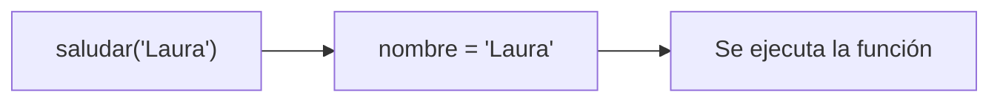

---

## 2.4. Varios parámetros

Una función puede recibir varios datos:

```python
def mostrar_alumno(nombre, edad):
    print(f"{nombre} tiene {edad} años")


mostrar_alumno("Laura", 18)
```

También podemos realizar cálculos:

```python
def sumar(a, b):
    return a + b


resultado = sumar(5, 3)
print(resultado)
```

---

# 3. El valor de retorno: `return`

## 3.1. ¿Qué hace `return`?

Una función puede **devolver un valor** al código que la ha llamado.

```python
def sumar(a, b):
    return a + b
```

Podemos guardar ese valor:

```python
resultado = sumar(5, 3)

print(resultado)
```

Resultado:

```text
8
```

El proceso puede representarse así:

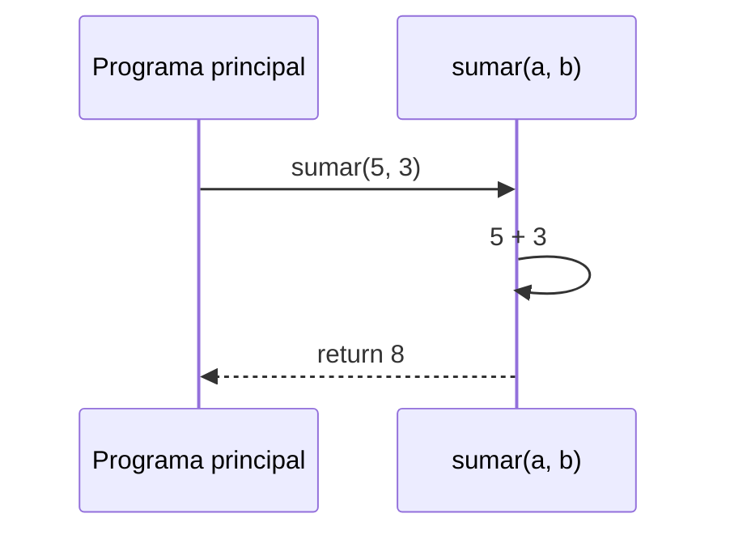

---

## 3.2. `print()` no es lo mismo que `return`

Este es uno de los conceptos más importantes de las funciones.

### Función que imprime

```python
def sumar(a, b):
    print(a + b)
```

La función muestra un resultado en pantalla, pero no lo devuelve.

### Función que devuelve

```python
def sumar(a, b):
    return a + b
```

Ahora podemos utilizar el resultado posteriormente:

```python
resultado = sumar(5, 3)

doble = resultado * 2

print(doble)
```

Resultado:

```text
16
```

!!! danger "`print()` y `return` no son equivalentes"
    `print()` **muestra información**.

    `return` **devuelve información** para que el resto del programa pueda utilizarla.

Una buena separación suele ser:

```python
def calcular_precio_final(precio, descuento):
    return precio - precio * descuento / 100


precio_final = calcular_precio_final(100, 20)

print(f"Precio final: {precio_final} €")
```

La función **calcula** y el programa principal decide cómo mostrar el resultado.

---

## 3.3. `return` finaliza la función

Cuando Python encuentra un `return`, termina inmediatamente la ejecución de la función.

```python
def comprobar_numero(numero):
    if numero < 0:
        return "Número negativo"

    return "Número positivo o cero"
```

Si `numero` es negativo, Python ejecutará el primer `return` y abandonará la función.

---

## 3.4. Funciones sin `return`

Si una función no contiene `return`, Python devuelve automáticamente el valor `None`.

```python
def saludar():
    print("Hola")


resultado = saludar()

print(resultado)
```

Resultado:

```text
Hola
None
```

!!! info "`None`"
    `None` representa la ausencia de un valor.

    No necesitamos utilizarlo normalmente en las primeras funciones, pero es importante saber que Python lo devuelve cuando una función no tiene un `return` explícito.

---

# 4. Formas habituales de crear funciones

## 4.1. Sin parámetros y sin retorno

```python
def mostrar_menu():
    print("1. Jugar")
    print("2. Configuración")
    print("3. Salir")


mostrar_menu()
```

La función simplemente realiza una acción.

---

## 4.2. Con parámetros y sin retorno

```python
def mostrar_mensaje(nombre):
    print(f"Bienvenido, {nombre}")


mostrar_mensaje("Carlos")
```

La función necesita datos para realizar su trabajo.

---

## 4.3. Con parámetros y con retorno

```python
def calcular_area_rectangulo(base, altura):
    return base * altura


area = calcular_area_rectangulo(5, 3)

print(area)
```

Este será uno de los tipos de función que más utilizaremos.

---

## 4.4. Parámetros con valores por defecto

Podemos indicar un valor que se utilizará si no enviamos un argumento.

```python
def saludar(nombre="invitado"):
    print(f"Hola, {nombre}")


saludar()
saludar("Laura")
```

Resultado:

```text
Hola, invitado
Hola, Laura
```

También podemos combinar parámetros obligatorios y opcionales:

```python
def calcular_precio(precio, descuento=0):
    return precio - precio * descuento / 100
```

```python
print(calcular_precio(100))
print(calcular_precio(100, 20))
```

Resultado:

```text
100.0
80.0
```

!!! warning "Orden de los parámetros"
    Los parámetros obligatorios deben aparecer antes que los parámetros con valor por defecto.

    Correcto:

    ```python
    def registrar_usuario(nombre, activo=True):
        ...
    ```

    Incorrecto:

    ```python
    def registrar_usuario(activo=True, nombre):
        ...
    ```

---

## 4.5. Devolver varios valores

Python permite devolver varios valores desde una función:

```python
def obtener_extremos(numeros):
    minimo = min(numeros)
    maximo = max(numeros)

    return minimo, maximo
```

Podemos recogerlos en dos variables:

```python
menor, mayor = obtener_extremos([4, 8, 2, 10, 6])

print("Mínimo:", menor)
print("Máximo:", mayor)
```

Resultado:

```text
Mínimo: 2
Máximo: 10
```

!!! note "¿Qué está ocurriendo realmente?"
    Python agrupa estos valores en una **tupla** y después podemos desempaquetarla en varias variables.

---

# 5. Ámbito de las variables

Las variables creadas dentro de una función normalmente solo existen dentro de esa función.

```python
def calcular_doble(numero):
    resultado = numero * 2
    return resultado
```

La variable `resultado` es una variable **local**.

Si intentamos utilizarla fuera:

```python
def calcular_doble(numero):
    resultado = numero * 2
    return resultado


print(resultado)
```

Python producirá un error porque `resultado` solo existe dentro de la función.

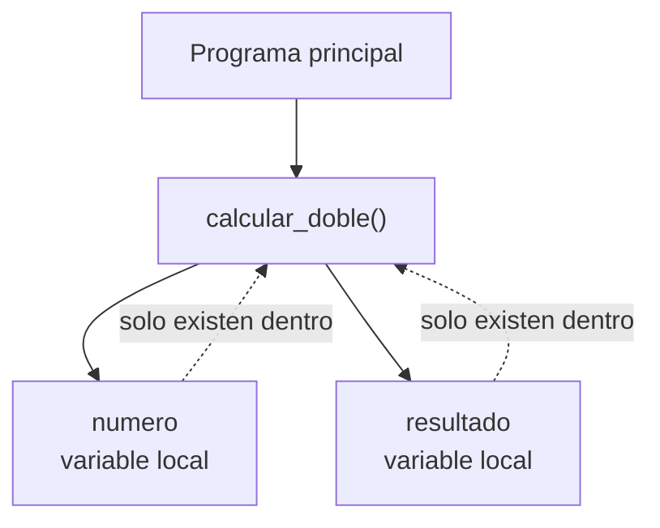

---

## 5.1. Variables locales

```python
def calcular_precio():
    precio = 10
    print(precio)
```

`precio` solo pertenece a la función.

---

## 5.2. Variables globales

Una variable creada fuera de las funciones pertenece al ámbito global:

```python
iva = 21


def mostrar_iva():
    print(iva)
```

La función puede leer esa variable.

Sin embargo, depender constantemente de variables globales puede hacer que el programa sea más difícil de entender y modificar.

En lugar de esto:

```python
descuento = 20


def calcular_precio(precio):
    return precio - precio * descuento / 100
```

es preferible:

```python
def calcular_precio(precio, descuento):
    return precio - precio * descuento / 100
```

!!! tip "Buena práctica"
    Siempre que sea posible, intenta que una función reciba mediante parámetros los datos que necesita y devuelva el resultado mediante `return`.

    Esto hace que la función sea más independiente y reutilizable.

---

# 6. Dividir problemas grandes en funciones

Una de las ventajas más importantes de las funciones es que permiten dividir un problema grande en problemas más pequeños.

Imagina un programa para gestionar las notas de un alumno.

Podríamos dividirlo así:

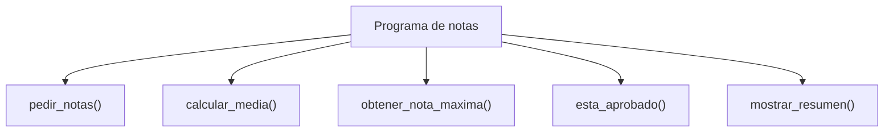

Cada función tiene una responsabilidad concreta.

Por ejemplo:

```python
def calcular_media(notas):
    return sum(notas) / len(notas)


def obtener_nota_maxima(notas):
    return max(notas)


def esta_aprobado(media):
    return media >= 5
```

Después el programa principal puede combinarlas:

```python
notas = [7, 8, 5, 9]

media = calcular_media(notas)
nota_maxima = obtener_nota_maxima(notas)
aprobado = esta_aprobado(media)

print(f"Media: {media}")
print(f"Nota máxima: {nota_maxima}")
print(f"Aprobado: {aprobado}")
```

!!! info "Análisis descendente"
    Una estrategia muy utilizada consiste en comenzar pensando en el problema general y dividirlo en tareas cada vez más pequeñas.

    A este enfoque se le suele llamar **diseño descendente** o **top-down**.

---

# 7. Documentar funciones

Cuando una función empieza a tener cierta importancia, es recomendable explicar qué hace.

Python permite utilizar **docstrings**:

```python
def calcular_media(notas):
    """Calcula y devuelve la media de una lista de notas."""
    return sum(notas) / len(notas)
```

La docstring aparece inmediatamente después de la definición de la función.

También podemos incluir más información:

```python
def calcular_precio_final(precio, descuento):
    """
    Calcula el precio final aplicando un descuento.

    precio: precio original del producto.
    descuento: porcentaje de descuento.
    """
    return precio - precio * descuento / 100
```

!!! tip "Comentarios y docstrings"
    No es necesario explicar instrucciones evidentes.

    Esto aporta poco:

    ```python
    # Sumamos a y b
    resultado = a + b
    ```

    Es más útil explicar **qué responsabilidad tiene la función** o **por qué se ha tomado una decisión**.

---

# 8. Buenas prácticas con funciones

Cuando crees funciones intenta seguir estas recomendaciones:

1. Utiliza nombres descriptivos.
2. Haz que cada función realice una tarea concreta.
3. Evita funciones excesivamente largas.
4. Utiliza parámetros para recibir los datos necesarios.
5. Utiliza `return` para devolver resultados.
6. Evita depender innecesariamente de variables globales.
7. Documenta las funciones cuando su funcionamiento no sea evidente.
8. Evita repetir código.

Por ejemplo, es preferible:

```python
def calcular_media(notas):
    return sum(notas) / len(notas)
```

que una función genérica como:

```python
def procesar(datos):
    # calcula medias
    # muestra mensajes
    # modifica datos
    # pide información
    # guarda resultados
    ...
```

!!! quote "Una función, una responsabilidad"
    Una buena función debería poder explicarse con una frase corta:

    - calcular una media;
    - comprobar una contraseña;
    - mostrar un menú;
    - buscar un usuario;
    - convertir una temperatura.

---

# 9. Errores frecuentes con funciones

## 9.1. Definir la función pero no llamarla

```python
def saludar():
    print("Hola")
```

No aparecerá nada en pantalla porque nunca ejecutamos:

```python
saludar()
```

---

## 9.2. Olvidar los paréntesis

```python
saludar
```

Esto hace referencia a la función, pero no la ejecuta.

Para ejecutarla:

```python
saludar()
```

---

## 9.3. Confundir `print()` con `return`

```python
def sumar(a, b):
    print(a + b)


resultado = sumar(4, 2)
print(resultado)
```

Resultado:

```text
6
None
```

Si queremos utilizar posteriormente el resultado:

```python
def sumar(a, b):
    return a + b
```

---

## 9.4. Enviar un número incorrecto de argumentos

```python
def sumar(a, b):
    return a + b


sumar(5)
```

La función necesita dos argumentos y solo hemos enviado uno.

---

## 9.5. Intentar utilizar una variable local fuera de la función

```python
def calcular():
    resultado = 10 * 2


print(resultado)
```

`resultado` solo existe dentro de `calcular()`.

---

# 10. De las funciones a los módulos

Las funciones nos permiten organizar el código **dentro de un archivo**.

Pero imaginemos que nuestro programa continúa creciendo:

```text
programa.py

mostrar_menu()
pedir_datos()
validar_numero()
calcular_media()
calcular_maximo()
calcular_minimo()
generar_informe()
guardar_resultado()
...
```

Podríamos terminar con cientos o miles de líneas dentro del mismo archivo.

La siguiente mejora consiste en separar las funciones relacionadas en diferentes archivos.

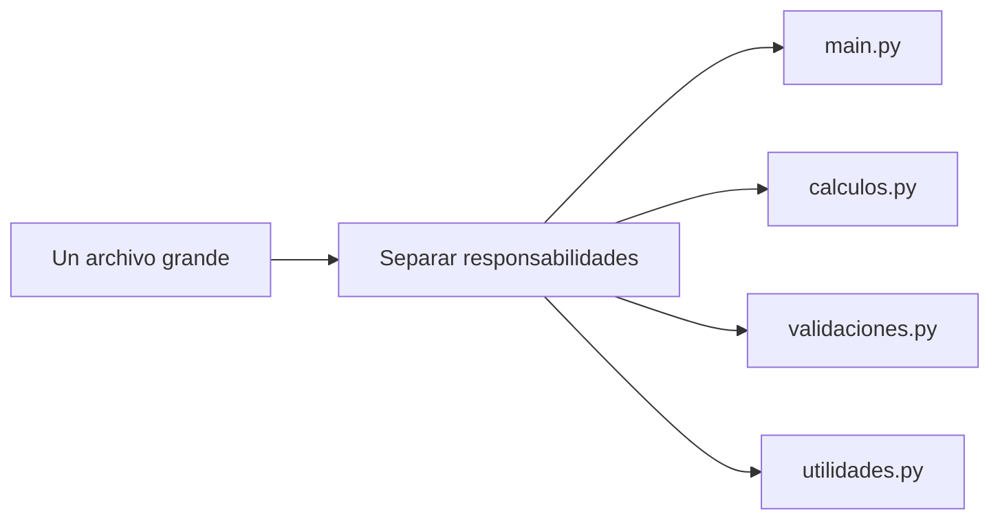

Antes:

```text
proyecto/
└── programa.py
```

Después:

```text
proyecto/
├── main.py
├── calculos.py
└── validaciones.py
```

Aquí aparece el concepto de **módulo**.

---

# 11. ¿Qué es un módulo?

Un **módulo** es, de forma sencilla, un archivo `.py` que contiene código Python que puede ser utilizado desde otros archivos.

Un módulo puede contener:

- funciones;
- variables;
- constantes;
- clases;
- instrucciones.

Por ejemplo:

```text
proyecto/
├── main.py
└── calculadora.py
```

`calculadora.py` es un módulo.

Podría contener:

```python
def sumar(a, b):
    return a + b


def restar(a, b):
    return a - b
```

El archivo `main.py` puede utilizar estas funciones sin tener que volver a escribirlas.

!!! info "Idea clave"
    Una **función** organiza instrucciones.

    Un **módulo** organiza funciones y otros elementos de Python dentro de un archivo.

---

# 12. Nuestro primer módulo

Vamos a crear un pequeño proyecto:

```text
calculadora/
├── main.py
└── operaciones.py
```

## 12.1. Archivo `operaciones.py`

```python
def sumar(a, b):
    return a + b


def restar(a, b):
    return a - b


def multiplicar(a, b):
    return a * b
```

Este archivo contiene las funciones relacionadas con las operaciones matemáticas.

## 12.2. Archivo `main.py`

```python
import operaciones


resultado = operaciones.sumar(10, 5)

print(resultado)
```

Resultado:

```text
15
```

Cuando escribimos:

```python
operaciones.sumar(10, 5)
```

podemos interpretar cada parte así:

```text
operaciones.sumar(10, 5)
│           │
│           └── función
│
└── módulo
```

!!! tip "Ventaja de escribir `modulo.funcion()`"
    Al leer:

    ```python
    operaciones.sumar(10, 5)
    ```

    sabemos inmediatamente que `sumar()` pertenece al módulo `operaciones`.

---

# 13. ¿Qué hace `import`?

Para utilizar un módulo necesitamos **importarlo**.

```python
import operaciones
```

De forma simplificada, Python:

1. busca el módulo;
2. carga el archivo;
3. ejecuta las instrucciones que encuentre en él;
4. crea una referencia al módulo;
5. permite acceder a sus elementos.

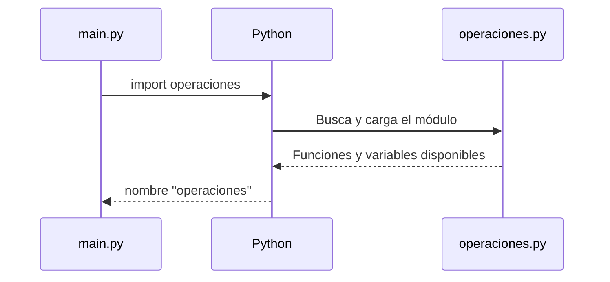

Después podemos utilizar:

```python
operaciones.sumar()
operaciones.restar()
operaciones.multiplicar()
```

---

# 14. Formas de importar módulos

Python permite importar módulos de distintas formas.

## 14.1. Importar el módulo completo

```python
import math

resultado = math.sqrt(25)

print(resultado)
```

Resultado:

```text
5.0
```

Tenemos que escribir:

```python
math.sqrt()
```

porque `sqrt()` pertenece al módulo `math`.

### Ventajas

- queda claro de qué módulo procede cada función;
- reduce los conflictos entre nombres;
- es fácil de leer.

!!! tip "Forma recomendada para empezar"
    Siempre que sea razonable, utilizaremos:

    ```python
    import modulo
    ```

    y después:

    ```python
    modulo.funcion()
    ```

---

## 14.2. Importar elementos concretos

También podemos importar únicamente una función:

```python
from math import sqrt

resultado = sqrt(25)

print(resultado)
```

Ahora ya no escribimos:

```python
math.sqrt(25)
```

sino:

```python
sqrt(25)
```

También podemos importar varios elementos:

```python
from math import sqrt, pi

print(sqrt(25))
print(pi)
```

!!! warning "Posibles conflictos"
    Cuando importamos funciones directamente puede ser menos evidente de dónde proceden.

    Por ejemplo:

    ```python
    from modulo_a import calcular
    from modulo_b import calcular
    ```

    ¿Qué función `calcular()` estamos utilizando?

---

## 14.3. Importar utilizando un alias

Podemos asignar un nombre alternativo a un módulo:

```python
import math as m

print(m.sqrt(25))
```

Esto es especialmente habitual con algunas librerías externas:

```python
import numpy as np
```

!!! note "Utiliza alias conocidos o útiles"
    No conviene acortar todos los nombres sin motivo.

    Esto:

    ```python
    import random as r
    ```

    probablemente es menos claro que:

    ```python
    import random
    ```

---

## 14.4. ¿Y `from modulo import *`?

Python permite escribir:

```python
from math import *
```

Esto importa todos los nombres públicos del módulo.

Aunque funciona, normalmente **deberíamos evitarlo**.

El problema es que después podemos encontrar código como:

```python
print(sqrt(25))
print(pi)
print(factorial(5))
```

y no queda claro de dónde procede cada elemento.

!!! danger "Evita `import *`"
    Preferiremos:

    ```python
    import math
    ```

    o, si necesitamos pocas funciones:

    ```python
    from math import sqrt, factorial
    ```

---

# 15. ¿Dónde colocar los `import`?

Los imports se suelen escribir al principio del archivo:

```python
import math
import random


def calcular(...):
    ...
```

Esto permite ver rápidamente qué módulos utiliza el programa.

Por ejemplo:

```python
import random


def lanzar_dado():
    return random.randint(1, 6)


resultado = lanzar_dado()

print(resultado)
```

---

# 16. Código que se ejecuta al importar

Observa este módulo:

`mensajes.py`

```python
def saludar(nombre):
    print(f"Hola, {nombre}")


print("Módulo mensajes cargado")
```

Y ahora:

`main.py`

```python
import mensajes
```

Al ejecutar `main.py` aparecerá:

```text
Módulo mensajes cargado
```

¿Por qué?

Porque al importar un módulo, Python ejecuta las instrucciones que se encuentran en el nivel principal del archivo.

Esto significa que debemos tener cuidado con el código que dejamos fuera de las funciones.

---

# 17. `__name__ == "__main__"`

Existe una técnica muy utilizada para diferenciar entre:

- ejecutar un archivo directamente;
- importar ese archivo como módulo.

Observa:

`operaciones.py`

```python
def sumar(a, b):
    return a + b


print(sumar(5, 3))
```

Si importamos este módulo:

```python
import operaciones
```

Python también ejecutará:

```python
print(sumar(5, 3))
```

y mostrará `8`, aunque nosotros solamente queríamos importar la función.

Podemos evitarlo utilizando:

```python
if __name__ == "__main__":
```

El módulo quedaría:

```python
def sumar(a, b):
    return a + b


if __name__ == "__main__":
    print(sumar(5, 3))
```

Ahora existen dos comportamientos.

### Si ejecutamos directamente

```bash
python operaciones.py
```

se ejecutará:

```python
print(sumar(5, 3))
```

### Si importamos

```python
import operaciones
```

ese bloque no se ejecutará.

!!! info "¿Para qué sirve?"
    Este patrón permite incluir pequeñas pruebas o un punto de entrada en un archivo sin que ese código se ejecute cuando el archivo se utiliza como módulo.

Por ahora basta con recordar esta estructura:

```python
if __name__ == "__main__":
    # Código que solo queremos ejecutar
    # cuando lanzamos este archivo directamente.
```

---

# 18. Tipos de módulos

No todos los módulos que importamos proceden del mismo lugar.

Podemos distinguir tres grupos principales:

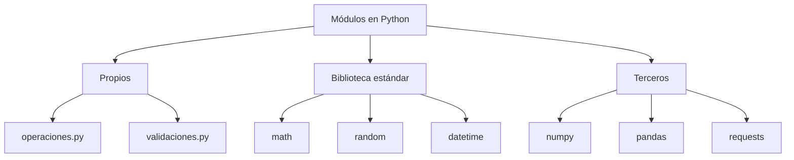

---

## 18.1. Módulos propios

Son archivos `.py` que creamos nosotros.

Ejemplo:

```text
proyecto/
├── main.py
└── calculadora.py
```

Podemos importarlo con:

```python
import calculadora
```

---

## 18.2. Biblioteca estándar de Python

Python incluye una gran colección de módulos que podemos utilizar sin instalar nada adicional.

Algunos ejemplos son:

- `math`: operaciones matemáticas;
- `random`: generación de valores aleatorios;
- `datetime`: fechas y horas;
- `statistics`: operaciones estadísticas;
- `os`: interacción con elementos del sistema operativo.

!!! info "No necesitas memorizar todos los módulos"
    Lo importante es saber que existe una **biblioteca estándar** y aprender a consultar la documentación cuando necesitemos resolver un problema.

---

## 18.3. Librerías externas

Existen miles de librerías creadas por la comunidad que no vienen instaladas con Python.

Algunos ejemplos conocidos son:

```text
NumPy
Pandas
Requests
Matplotlib
Flask
Django
```

Normalmente debemos instalarlas antes de utilizarlas.

Por ejemplo:

```bash
pip install numpy
```

Después:

```python
import numpy
```

!!! warning "Importar no instala"
    Esta instrucción:

    ```python
    import numpy
    ```

    no instala NumPy.

    Solo intenta cargar una librería que ya debe estar disponible en nuestro entorno de Python.

---

# 19. Algunos módulos de la biblioteca estándar

## 19.1. `math`

El módulo `math` contiene funciones y constantes matemáticas.

```python
import math


print(math.sqrt(25))
print(math.pi)
print(math.factorial(5))
```

Resultado aproximado:

```text
5.0
3.141592653589793
120
```

Ejemplo:

```python
import math


def calcular_area_circulo(radio):
    return math.pi * radio ** 2


area = calcular_area_circulo(5)

print(area)
```

---

## 19.2. `random`

Permite generar valores pseudoaleatorios.

```python
import random


numero = random.randint(1, 10)

print(numero)
```

`randint(1, 10)` genera un número entero entre 1 y 10, ambos incluidos.

También podemos elegir un elemento de una lista:

```python
import random


mapas = ["Terminal", "Raid", "Nuketown", "Firing Range"]

mapa_elegido = random.choice(mapas)

print(mapa_elegido)
```

!!! example "Aplicación"
    `random` resulta especialmente útil para juegos, sorteos, simulaciones y selección aleatoria de elementos.

---

## 19.3. `datetime`

El módulo `datetime` permite trabajar con fechas y horas.

```python
from datetime import datetime


ahora = datetime.now()

print(ahora)
```

Podemos formatear una fecha:

```python
from datetime import datetime


ahora = datetime.now()

print(ahora.strftime("%d/%m/%Y"))
```

---

## 19.4. `statistics`

Este módulo incluye algunas operaciones estadísticas habituales.

```python
import statistics


notas = [7, 5, 9, 8, 6]

media = statistics.mean(notas)

print(media)
```

Resultado:

```text
7
```

---

# 20. Módulo vs paquete

Hasta ahora hemos trabajado con **módulos**, es decir, archivos `.py`.

Cuando un proyecto crece todavía más podemos agrupar varios módulos relacionados dentro de una carpeta.

A esta agrupación la llamamos **paquete**.

```text
tienda/
├── main.py
└── ventas/
    ├── __init__.py
    ├── clientes.py
    └── facturacion.py
```

En este ejemplo:

- `clientes.py` es un módulo;
- `facturacion.py` es un módulo;
- `ventas` es un paquete.

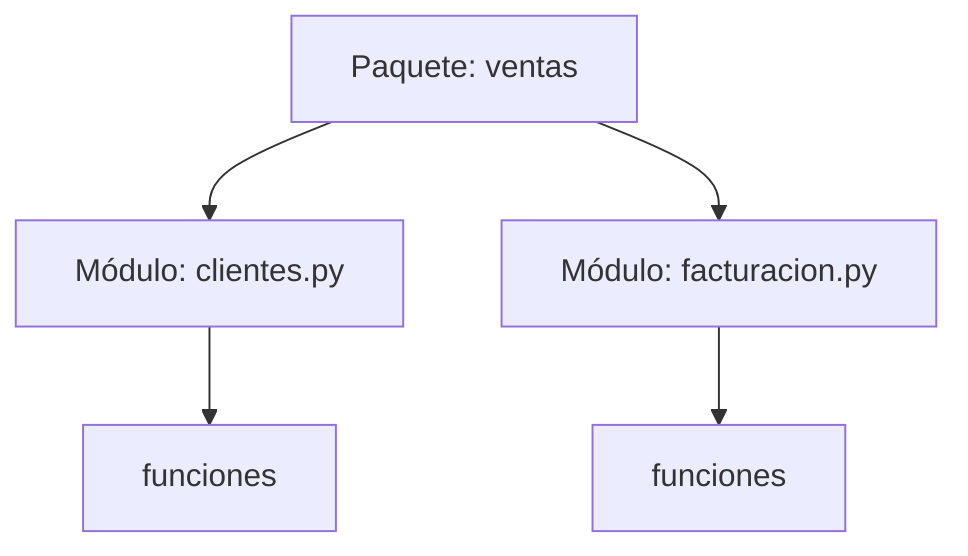

!!! note "`__init__.py`"
    En nuestros proyectos utilizaremos normalmente un archivo llamado `__init__.py` dentro del paquete.

    Puede estar vacío.

    Python moderno también permite algunos tipos de paquetes sin este archivo, pero para nuestros ejemplos utilizaremos la estructura tradicional porque hace explícito que esa carpeta forma parte del código Python.

---

# 21. Importar desde un paquete

Imaginemos esta estructura:

```text
tienda/
├── main.py
└── ventas/
    ├── __init__.py
    └── facturacion.py
```

`facturacion.py`:

```python
def calcular_total(precios):
    return sum(precios)
```

Desde `main.py` podemos escribir:

```python
from ventas.facturacion import calcular_total


precios = [20, 15, 30]

total = calcular_total(precios)

print(total)
```

También podríamos importar el módulo:

```python
from ventas import facturacion


total = facturacion.calcular_total([20, 15, 30])

print(total)
```

!!! tip "No hace falta complicarlo todavía"
    En esta unidad lo importante es comprender:

    ```text
    función → módulo → paquete
    ```

    Los proyectos grandes pueden tener estructuras mucho más complejas, pero todas parten de estas mismas ideas.

---

# 22. Errores frecuentes con módulos

## 22.1. `ModuleNotFoundError`

Ejemplo:

```python
import calculadora
```

Python puede mostrar:

```text
ModuleNotFoundError: No module named 'calculadora'
```

Puede ocurrir porque:

- el archivo no existe;
- el nombre está mal escrito;
- el módulo se encuentra en otra ubicación;
- la librería externa no está instalada.

---

## 22.2. Importar una función que no existe

```python
from operaciones import dividir
```

Si `operaciones.py` no contiene una función llamada `dividir`, Python producirá un error.

---

## 22.3. Confundir el nombre del módulo

Si tenemos:

```text
operaciones.py
```

debemos escribir:

```python
import operaciones
```

y no:

```python
import operacion
```

---

## 22.4. Utilizar nombres de archivos que coinciden con módulos existentes

Supongamos que creamos este archivo:

```text
random.py
```

Y dentro de otro archivo escribimos:

```python
import random
```

Python puede importar nuestro archivo en lugar del módulo estándar que esperábamos utilizar.

Por eso conviene evitar nombres como:

```text
random.py
math.py
datetime.py
statistics.py
```

cuando queremos utilizar esos módulos de Python.

!!! danger "Error muy habitual"
    Si un `import` se comporta de forma extraña, comprueba primero que no hayas dado a tu propio archivo el mismo nombre que el módulo que intentas importar.

---

## 22.5. Crear dependencias innecesarias entre módulos

Es posible que varios módulos comiencen a importarse unos a otros de forma difícil de seguir.

Para empezar intentaremos mantener una estructura sencilla:

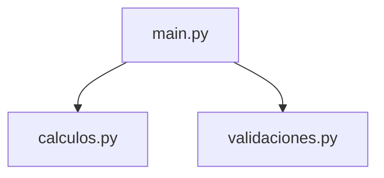

en lugar de:

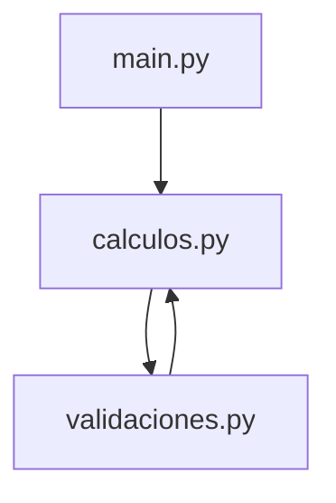

La segunda estructura puede generar importaciones circulares y hace el proyecto más difícil de comprender.

---

# 23. Buenas prácticas con módulos

## Nombres descriptivos

Mejor:

```text
calculos.py
validaciones.py
usuarios.py
estadisticas.py
```

que:

```text
mod1.py
cosas.py
prueba.py
archivo2.py
```

---

## Agrupar elementos relacionados

Un módulo debería contener elementos que tengan relación entre sí.

Por ejemplo:

`calculos.py`

```python
def calcular_media(...):
    ...


def calcular_maximo(...):
    ...


def calcular_minimo(...):
    ...
```

Y no mezclar sin motivo:

```python
def calcular_media(...):
    ...


def enviar_email(...):
    ...


def generar_contrasena(...):
    ...
```

---

## Mantener `main.py` sencillo

Una estructura habitual consiste en utilizar `main.py` para coordinar el programa y trasladar la lógica a funciones y módulos.

```python
import estadisticas


notas = [7, 8, 5, 9]

media = estadisticas.calcular_media(notas)

print(f"Media: {media}")
```

`main.py` debería permitir entender con facilidad **qué hace el programa**, mientras que los detalles pueden encontrarse en los módulos correspondientes.

---

## Evitar `from modulo import *`

Preferiremos imports explícitos.

Mejor:

```python
import math

print(math.sqrt(25))
```

o:

```python
from math import sqrt

print(sqrt(25))
```

que:

```python
from math import *
```

---

## Documentar los módulos

Podemos añadir una docstring al principio del archivo:

```python
"""Funciones relacionadas con el cálculo de estadísticas."""
```

Ejemplo:

```python
"""Funciones relacionadas con el cálculo de estadísticas."""


def calcular_media(notas):
    """Devuelve la media de una lista de notas."""
    return sum(notas) / len(notas)
```

---

# 24. Ejemplo completo: organizar un programa en módulos

Vamos a transformar un pequeño programa de estadísticas de notas en un proyecto organizado.

## 24.1. Primera versión: todo en un archivo

```python
notas = [7, 5, 9, 6, 8]

media = sum(notas) / len(notas)
maxima = max(notas)
minima = min(notas)

print(f"Media: {media}")
print(f"Máxima: {maxima}")
print(f"Mínima: {minima}")
```

Funciona correctamente, pero los cálculos están mezclados con el programa principal.

---

## 24.2. Segunda versión: utilizar funciones

```python
def calcular_media(notas):
    return sum(notas) / len(notas)


def obtener_maxima(notas):
    return max(notas)


def obtener_minima(notas):
    return min(notas)


notas = [7, 5, 9, 6, 8]

media = calcular_media(notas)
maxima = obtener_maxima(notas)
minima = obtener_minima(notas)

print(f"Media: {media}")
print(f"Máxima: {maxima}")
print(f"Mínima: {minima}")
```

Ahora el programa está mejor organizado.

---

## 24.3. Tercera versión: separar las funciones en un módulo

Estructura:

```text
notas/
├── main.py
└── estadisticas.py
```

### `estadisticas.py`

```python
"""Funciones para calcular estadísticas de una lista de notas."""


def calcular_media(notas):
    return sum(notas) / len(notas)


def obtener_maxima(notas):
    return max(notas)


def obtener_minima(notas):
    return min(notas)


def esta_aprobado(media):
    return media >= 5
```

### `main.py`

```python
import estadisticas


notas = [7, 5, 9, 6, 8]

media = estadisticas.calcular_media(notas)
maxima = estadisticas.obtener_maxima(notas)
minima = estadisticas.obtener_minima(notas)
aprobado = estadisticas.esta_aprobado(media)

print(f"Media: {media}")
print(f"Máxima: {maxima}")
print(f"Mínima: {minima}")

if aprobado:
    print("El alumno está aprobado")
else:
    print("El alumno está suspendido")
```

Ahora cada archivo tiene una responsabilidad clara:

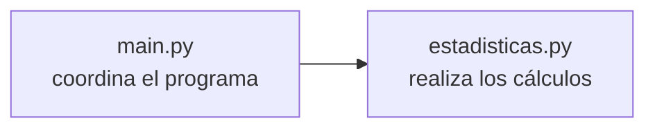

!!! success "Evolución del programa"
    Hemos pasado por tres etapas:

    ```text
    instrucciones
        ↓
    funciones
        ↓
    módulos
    ```

    El programa realiza prácticamente lo mismo, pero su organización ha mejorado.

---

# 25. ¿Cuándo crear una función y cuándo crear un módulo?

Puede surgir una duda:

> ¿Tengo que crear un módulo para cada función?

No.

Un módulo puede contener varias funciones relacionadas.

Por ejemplo:

```text
estadisticas.py
```

puede contener:

```python
calcular_media()
obtener_maximo()
obtener_minimo()
calcular_mediana()
```

Todas pertenecen al mismo tema.

Podemos pensar en distintos niveles de organización:

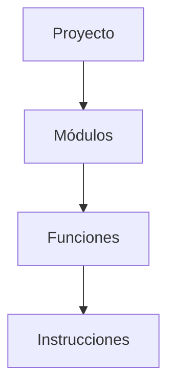

!!! example "Analogía"
    Podemos imaginar un proyecto como un archivador:

    - **proyecto** → archivador;
    - **módulo** → carpeta;
    - **función** → documento;
    - **instrucciones** → contenido del documento.

---

# 26. Resumen de la unidad

## Funciones

Una función:

```python
def sumar(a, b):
    return a + b
```

nos permite encapsular una tarea para reutilizarla.

Conceptos importantes:

```text
def
parámetros
argumentos
return
variables locales
docstrings
```

---

## Módulos

Un módulo es un archivo `.py`:

```text
operaciones.py
```

que podemos utilizar desde otro archivo:

```python
import operaciones

resultado = operaciones.sumar(5, 3)
```

---

## Paquetes

Un paquete agrupa módulos:

```text
ventas/
├── __init__.py
├── clientes.py
└── facturacion.py
```

---

## Mapa conceptual

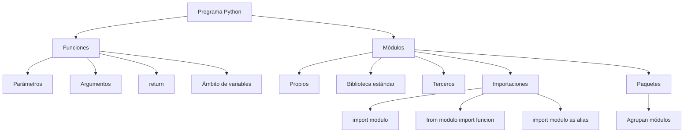

---

# 27. Antes de continuar

Deberías poder responder a estas preguntas:

1. ¿Qué diferencia existe entre definir una función y llamarla?
2. ¿Qué diferencia existe entre un parámetro y un argumento?
3. ¿Qué diferencia existe entre `print()` y `return`?
4. ¿Qué es una variable local?
5. ¿Por qué es útil dividir un programa en funciones?
6. ¿Qué es un módulo?
7. ¿Cómo importamos un módulo?
8. ¿Qué diferencia existe entre `import math` y `from math import sqrt`?
9. ¿Qué ocurre con el código que se encuentra fuera de las funciones cuando importamos un módulo?
10. ¿Para qué sirve `if __name__ == "__main__":`?
11. ¿Qué diferencia existe entre un módulo propio y uno de la biblioteca estándar?
12. ¿Qué diferencia existe entre un módulo y un paquete?

!!! success "Objetivo final"
    Si puedes coger un programa que está escrito completamente en un único archivo, dividirlo en funciones y después mover algunas de esas funciones a módulos relacionados, has comprendido la idea principal de esta unidad.

---

# 28. Ejercicios de clase

## Funciones

[Ejercicios de clase UT4: Funciones](ejercicios_funciones_clase/)

## Módulos

[Ejercicios de clase UT4: Importar módulos](ejercicios_importar_modulos_clase/)
