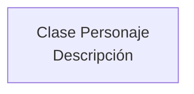
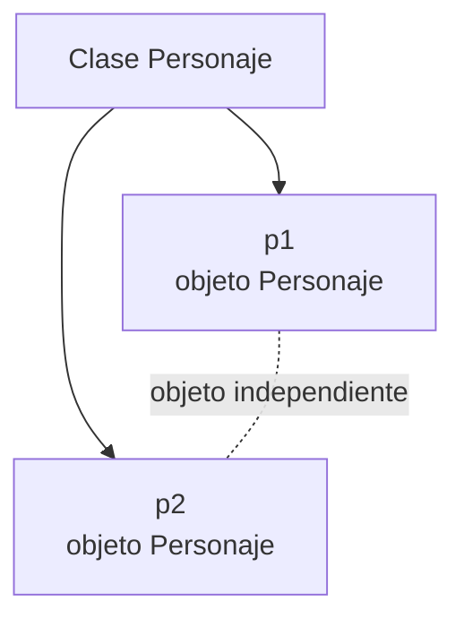
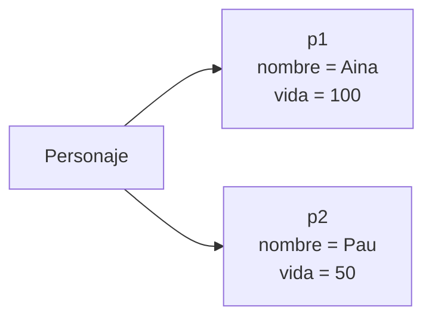
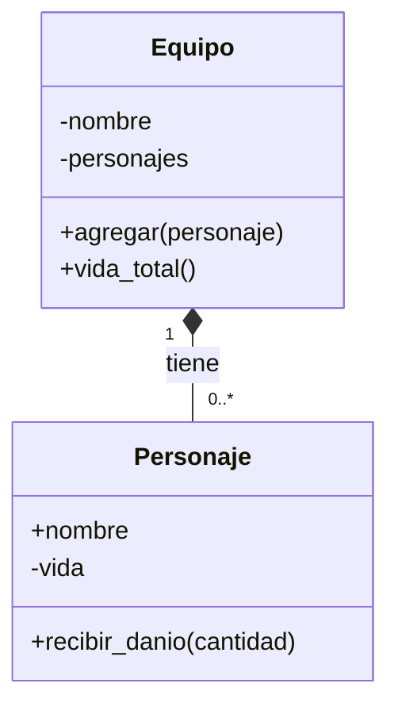
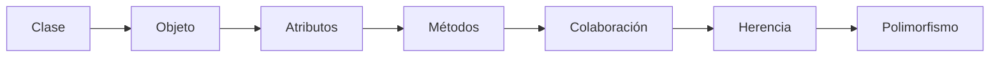

# UT6: Programación orientada a objetos (POO) en Python

## Introducción

En esta unidad aprenderás a crear tus propios tipos de elementos en Python. Un
personaje puede tener un nombre y una cantidad de vida, y también puede hacer
acciones como presentarse, atacar o recibir daño.

Piensa en un juego sencillo: ¿cómo crearíamos muchos personajes distintos,
cada uno con sus propios datos y acciones? Vamos a construir la respuesta paso
a paso, empezando por el código más pequeño posible y añadiendo una idea cada
vez.

Al terminar podrás crear clases y objetos, guardar datos en cada objeto,
definir métodos, organizar una colección de personajes y ampliar un personaje
con tipos especializados como `Guerrero` y `Mago`. También aprenderás a
comprobar los datos y a organizar las clases en varios archivos.

!!! info "Cómo estudiar esta página"
    Copia los ejemplos en un archivo, ejecútalos y cambia una sola cosa cada
    vez. Antes de ejecutar, intenta predecir la salida. Las microactividades
    están pensadas para durar entre dos y cinco minutos.

## 1. ¿Qué es una clase?

Una **clase** es una descripción o plantilla. Indica cómo serán ciertos
elementos de nuestro programa. En esta unidad vamos a describir personajes.

Este es el primer código de la unidad:

```python
class Personaje:
    pass
```

Aunque es muy corto, cada parte tiene un significado:

- `class` indica que vamos a definir una clase.
- `Personaje` es el nombre de la clase. Las clases se escriben normalmente con
  la primera letra de cada palabra en mayúscula.
- `:` indica que comienza el contenido de la clase.
- Las líneas sangradas pertenecen a la clase.
- `pass` significa “no hay instrucciones todavía”. Sirve para crear una clase
  vacía mientras aprendemos o mientras decidimos qué necesitará.

El bloque es correcto y se puede ejecutar. Por ahora, `Personaje` solo es una
descripción sin datos ni acciones.



Todavía no hemos creado ningún personaje concreto. Solo hemos escrito la
plantilla que utilizaremos en el apartado siguiente.

### Microactividad: reconocer una clase

Durante dos minutos:

1. Señala en `class Personaje:` cuál es la palabra reservada y cuál es el
   nombre elegido para la clase.
2. Crea una segunda clase vacía llamada `Equipo`.
3. Comprueba que ambas definiciones se ejecutan sin mostrar errores.

## 2. ¿Qué es un objeto o instancia?

Un **objeto** es un elemento concreto creado a partir de una clase. Si la clase
es la descripción de un personaje, un objeto es un personaje concreto.
También llamamos **instancia** a un objeto creado a partir de una clase.

El siguiente bloque es completo y ejecutable:

```python
class Personaje:
    pass


p1 = Personaje()
p2 = Personaje()

print(type(p1).__name__)  # Personaje
print(p1 is p2)           # False
```

`Personaje()` significa “crea un objeto siguiendo la clase `Personaje`”.
Después guardamos el primer objeto en `p1` y el segundo en `p2`.

`p1` y `p2` son dos objetos distintos aunque procedan de la misma clase. La
expresión `p1 is p2` pregunta si los dos nombres señalan exactamente al mismo
objeto. Como hemos creado dos objetos, el resultado es `False`.



La clase proporciona la forma general; cada objeto será un ejemplar separado.
Más adelante guardaremos datos diferentes en cada uno.

### Microactividad: crear instancias

Escribe y ejecuta este cambio:

```python
class Personaje:
    pass


p1 = Personaje()
p3 = Personaje()
print(p3 is p1)  # ¿True o False?
```

Predice la salida antes de ejecutar. Después explica con una frase por qué `p3`
no es el mismo objeto que `p1`.

## 3. Atributos: los datos de un objeto

Un **atributo** es un dato que pertenece a un objeto. Un personaje puede tener
atributos como `nombre`, `vida` o `nivel`.

Para ver cómo se accede a un atributo, usaremos temporalmente dos objetos
vacíos. Esta forma de asignar los datos nos ayuda a observar el punto, pero no
será nuestra forma principal de diseñar la clase: en el apartado 4 aprenderemos
a inicializar los objetos de manera ordenada.

```python
class Personaje:
    pass


p1 = Personaje()
p2 = Personaje()

p1.nombre = "Aina"
p2.nombre = "Pau"

print(p1.nombre)  # Aina
print(p2.nombre)  # Pau

p1.nombre = "Aina la exploradora"
print(p1.nombre)  # Aina la exploradora
print(p2.nombre)  # Pau
```

El punto (`.`) permite acceder a un atributo:

- `p1.nombre` lee el atributo `nombre` de `p1`.
- `p1.nombre = ...` cambia ese atributo de `p1`.
- Cambiar `p1.nombre` no cambia `p2.nombre`, porque son objetos diferentes.

Podemos añadir otro atributo del mismo modo:

```python
class Personaje:
    pass


p1 = Personaje()
p2 = Personaje()
p1.vida = 100
p2.vida = 50

print(p1.vida)  # 100
print(p2.vida)  # 50
```

En este momento la clase no obliga a que todos los personajes tengan los mismos
atributos. Precisamente por eso, para un programa real preferiremos preparar
los datos al crear cada objeto.

### Microactividad: dos estados independientes

Añade `nivel` a `p1` y `p2`, con valores 3 y 7. Después cambia solo el nivel de
`p1` a 4 y muestra los dos niveles. El resultado debería ser 4 y 7.

En el diagrama, cada instancia tiene sus propios valores:



## 4. `__init__`: dar valores iniciales al crear objetos

Escribir cada atributo después de crear el objeto puede provocar olvidos. El
método especial `__init__` permite indicar qué datos necesita el objeto desde
el momento en que se crea.

Este bloque es completo y no utiliza todavía validaciones:

```python
class Personaje:
    def __init__(self, nombre, vida):
        self.nombre = nombre
        self.vida = vida


p1 = Personaje("Aina", 100)
p2 = Personaje("Pau", 50)

print(p1.nombre)  # Aina
print(p2.vida)    # 50
```

Vamos a leer el inicializador línea a línea:

- `def` empieza una definición de función.
- `__init__` es el nombre del inicializador que Python ejecuta al crear un
  objeto.
- `self` representa el objeto concreto que se está inicializando.
- `nombre` y `vida` son los datos que recibirá ese objeto.

Las instrucciones `self.nombre = nombre` y `self.vida = vida` guardan los
valores en la instancia.

La parte izquierda (`self.nombre`) es el atributo que quedará guardado en el
objeto. La parte derecha (`nombre`) es el dato recibido como parámetro. La
asignación conecta ambos.

Cuando escribimos `p1 = Personaje("Aina", 100)`

ocurre, de forma resumida, lo siguiente:

1. Python crea un objeto que pertenece a la clase `Personaje`.
2. Llama a `__init__` para preparar ese objeto.
3. Coloca `"Aina"` en el parámetro `nombre` y `100` en `vida`.
4. Guarda esos valores en `p1.nombre` y `p1.vida`.
5. `p1` queda asociado al objeto preparado.

`__init__` **inicializa** el objeto. No necesitas conocer otros métodos
internos para utilizarlo.

### Microactividad: añadir un dato inicial

Modifica la clase completa para que `__init__` reciba también `nivel`. Crea
`Personaje("Aina", 100, 3)` y `Personaje("Pau", 50, 7)`. Comprueba que puedes
mostrar `p1.nivel` y `p2.nivel`.

## 5. `self`: ¿a qué objeto nos estamos refiriendo?

`self` es el objeto concreto que participa en una llamada. Si existen `p1` y
`p2`, los dos usan la misma definición de la clase, pero cada llamada trabaja
con una instancia diferente.

Observa este ejemplo completo:

```python
class Personaje:
    def __init__(self, nombre):
        self.nombre = nombre

    def presentarse(self):
        return f"Soy {self.nombre}"


p1 = Personaje("Aina")
p2 = Personaje("Pau")

print(p1.presentarse())  # Soy Aina
print(p2.presentarse())  # Soy Pau
```

Cuando escribimos `p1.presentarse()`, `self` representa a `p1`. Cuando
escribimos `p2.presentarse()`, `self` representa a `p2`. El método es el mismo,
pero el objeto utilizado cambia.

Podemos expresar la idea de forma equivalente, aunque normalmente usaremos la
primera forma:

```python
class Personaje:
    def __init__(self, nombre):
        self.nombre = nombre

    def presentarse(self):
        return f"Soy {self.nombre}"


p1 = Personaje("Aina")
print(p1.presentarse())          # Soy Aina
print(Personaje.presentarse(p1)) # Soy Aina
```

En la primera llamada Python entrega `p1` automáticamente como `self`. En la
segunda lo escribimos explícitamente para observar qué está pasando.

### Parámetro y atributo no son lo mismo

En el método `def __init__(self, nombre):` la instrucción
`self.nombre = nombre` guarda el dato en la instancia.

`nombre` es un **parámetro**. Solo sirve dentro de la llamada al método.
`self.nombre` es un **atributo**. Queda guardado en el objeto y puede
consultarse después desde otros métodos.

Si escribiéramos `nombre = nombre`, estaríamos asignando el parámetro a sí
mismo. El objeto no recibiría el atributo que necesitamos. La forma correcta
es `self.nombre = nombre`.

### ¿Se escribe `self` al llamar?

No. Al definir un método sí se escribe como primer parámetro:

Al definirlo escribimos `def presentarse(self):` y dentro podemos devolver
`f"Soy {self.nombre}"`.

Al llamar se escribe el objeto y el nombre del método:

Al llamar se escribe `p1.presentarse()`.

No escribimos `p1.presentarse(p1)`. Python ya sabe que `p1` es el objeto que
debe ocupar el lugar de `self`.

!!! warning "Error habitual"
    Si olvidas `self` al definir un método, Python no podrá asociar
    correctamente la llamada con el objeto. Comprueba siempre que todos los
    métodos de instancia empiezan por `self`.

### Microactividad 1: predecir

Sin ejecutar, responde:

```python
class Personaje:
    def __init__(self, nombre):
        self.nombre = nombre

    def presentarse(self):
        return f"Soy {self.nombre}"


p1 = Personaje("Aina")
p2 = Personaje("Pau")
print(p1.presentarse())
print(p2.presentarse())
```

¿Qué nombre aparece en cada línea? Explica qué objeto representa `self` en cada
llamada.

### Microactividad 2: corregir una asignación

Revisa esta línea de un constructor que estás escribiendo: `nombre = nombre`.

Corrígela para que el nombre quede guardado en el objeto y prueba después
`print(personaje.nombre)`. La corrección debe utilizar `self`.

## 6. Métodos: las acciones de los objetos

Un **método** es una función que forma parte de una clase. Un método puede
consultar un atributo, modificarlo o devolver un resultado.

Primero veremos un método sin datos adicionales. Después añadiremos un método
que recibe un parámetro además de `self`.

El siguiente bloque es una versión completa de `Personaje`:

```python
class Personaje:
    def __init__(self, nombre, vida):
        self.nombre = nombre
        self.vida = vida

    def presentarse(self):
        return f"Soy {self.nombre} y tengo {self.vida} puntos de vida"

    def recibir_danio(self, cantidad):
        self.vida = self.vida - cantidad

    def esta_vivo(self):
        return self.vida > 0


p1 = Personaje("Aina", 100)
print(p1.presentarse())       # Soy Aina y tengo 100 puntos de vida
print(p1.esta_vivo())         # True

p1.recibir_danio(30)
print(p1.vida)                # 70
print(p1.esta_vivo())         # True
```

`presentarse()` consulta el estado y devuelve un texto. `recibir_danio(30)`
recibe `30` en `cantidad` y modifica `self.vida`. `esta_vivo()` consulta la
vida y devuelve `True` o `False`.

En esta primera versión todavía no hemos decidido qué hacer con un daño
negativo o con una vida menor que cero. Lo estudiaremos después de practicar la
relación entre objetos y métodos.

### `return` y `print()`

`print()` muestra algo en pantalla. `return` entrega un resultado al código que
ha llamado al método. Normalmente las reglas de una clase deben devolver datos,
para que otra parte del programa decida qué hacer con ellos.

```python
class Personaje:
    def __init__(self, nombre, vida):
        self.nombre = nombre
        self.vida = vida

    def texto_estado(self):
        return f"{self.nombre}: {self.vida} PV"

    def mostrar_estado(self):
        print(self.texto_estado())


p1 = Personaje("Aina", 80)
estado = p1.texto_estado()
print(estado)                  # Aina: 80 PV
p1.mostrar_estado()            # Aina: 80 PV
```

`texto_estado()` devuelve una cadena que podemos guardar en `estado`. La
función `mostrar_estado()` imprime directamente. Ambas pueden ser útiles, pero
no hacen lo mismo.

### Microactividad 1: añadir `curar`

Añade a la primera versión de `Personaje` un método `curar(cantidad)` que sume
la cantidad recibida a `self.vida`. Crea un personaje con 40 de vida, recibe 10
de daño y después se cura 5. Muestra la vida tras cada llamada.

### Microactividad 2: dos objetos

Sin ejecutar primero, predice la vida final:

Usa la versión completa anterior para crear `p1 = Personaje("Aina", 100)` y
`p2 = Personaje("Pau", 50)`, aplicar `p1.recibir_danio(20)` y
`p2.recibir_danio(5)`, y mostrar sus vidas.

Después ejecuta el código y explica por qué una llamada no modifica el otro
objeto.

## ¿Lo tienes claro?

Haz esta comprobación antes de continuar. No copies una solución completa:
escribe una clase nueva llamada `Libro` o `Mascota` que tenga:

1. un `__init__` con dos datos, por ejemplo `titulo` y `autor`;
2. dos atributos guardados mediante `self`;
3. un método que devuelva una frase usando esos atributos;
4. dos instancias con valores distintos;
5. dos llamadas al método y una modificación de un solo objeto.

Puedes comprobar tu resultado con estos criterios:

- la clase se puede ejecutar sin errores;
- cada instancia muestra sus propios datos;
- el método devuelve una cadena que el programa puede guardar en una variable;
- modificar la primera instancia no cambia la segunda;
- puedes explicar qué representa `self` en el método.

Si todavía dudas entre parámetro y atributo, vuelve a ejecutar el ejemplo de
`Personaje` y señala la parte izquierda y la parte derecha de
`self.nombre = nombre`.

## 7. Varios objetos: listas de instancias

Una lista puede guardar objetos del mismo modo que guarda números o cadenas.
La diferencia importante es que cada elemento de la lista es una instancia
completa con sus propios atributos y métodos.

Este ejemplo es autónomo:

```python
class Personaje:
    def __init__(self, nombre, vida):
        self.nombre = nombre
        self.vida = vida

    def presentarse(self):
        return f"{self.nombre}: {self.vida} PV"


personajes = [
    Personaje("Aina", 100),
    Personaje("Pau", 70),
    Personaje("Nora", 120),
]

for personaje in personajes:
    print(personaje.presentarse())

personaje_mas_resistente = personajes[0]
for personaje in personajes[1:]:
    if personaje.vida > personaje_mas_resistente.vida:
        personaje_mas_resistente = personaje

print(personaje_mas_resistente.nombre)  # Nora
```

El bucle `for` obtiene una instancia en cada vuelta. Por eso podemos escribir
`personaje.vida` y `personaje.presentarse()`.

Una lista de objetos no convierte esos objetos en diccionarios ni elimina sus
métodos. Cada elemento sigue siendo un `Personaje`.

### Microactividad: buscar un personaje

Añade un cuarto personaje a la lista. Cambia su vida para que sea la mayor y
comprueba que el algoritmo lo encuentra. Después modifica solo la vida de un
personaje y vuelve a imprimir los originales para observar que cada uno
conserva su propio estado.

## 8. Reglas y validaciones para conservar un estado correcto

Ya sabemos crear objetos, guardar atributos y llamar a métodos. Ahora podemos
decidir qué valores son aceptables. Una vida negativa no representa un estado
útil y un daño negativo aumentaría la vida en lugar de reducirla.

Primero limitaremos la vida a cero con `max(0, ...)`. Después rechazaremos un
daño negativo mediante `ValueError`.

```python
class Personaje:
    def __init__(self, nombre, vida):
        self.nombre = nombre
        self.vida = vida

    def recibir_danio(self, cantidad):
        if cantidad < 0:
            raise ValueError("El daño no puede ser negativo")
        self.vida = max(0, self.vida - cantidad)

    def curar(self, cantidad):
        if cantidad < 0:
            raise ValueError("La curación no puede ser negativa")
        self.vida += cantidad

    def esta_vivo(self):
        return self.vida > 0


p1 = Personaje("Aina", 30)
p1.recibir_danio(50)
print(p1.vida)         # 0
print(p1.esta_vivo())  # False

try:
    p1.recibir_danio(-5)
except ValueError as error:
    print(error)        # El daño no puede ser negativo
```

`raise ValueError(...)` comunica que el valor recibido no es aceptable. El
bloque `try`/`except` permite que la parte que utiliza la clase decida cómo
informar del problema sin cerrar todo el programa.

Fíjate en el orden: primero comprobamos el daño y solo después modificamos la
vida. Si el daño es inválido, la vida conserva el valor anterior. Esta regla de
mantener siempre un estado correcto recibe también el nombre de **invariante**,
pero lo importante ahora es saber aplicarla.

### Microactividad: comprobar antes de modificar

1. Crea un personaje con 40 de vida.
2. Guarda su vida en una variable llamada `vida_anterior`.
3. Intenta aplicar `-10` de daño dentro de un `try`/`except`.
4. Comprueba que la vida sigue siendo 40 después del error.

## 9. Encapsulación: proteger los datos

La **encapsulación** consiste en controlar cómo se consulta o se modifica un
dato para no romper las reglas de la clase. No significa esconder todo sin
motivo: significa ofrecer operaciones claras para trabajar con el objeto.

Usaremos `_vida` para indicar que la vida es un dato de uso interno. El guion
bajo es una convención de Python: no impide realmente que otro código escriba
`personaje._vida`. Sirve para comunicar que debería utilizar los métodos de la
clase.

```python
class Personaje:
    def __init__(self, nombre, vida):
        self.nombre = nombre
        self._vida = vida

    @property
    def vida(self):
        return self._vida

    def recibir_danio(self, cantidad):
        if cantidad < 0:
            raise ValueError("El daño no puede ser negativo")
        self._vida = max(0, self._vida - cantidad)

    def curar(self, cantidad):
        if cantidad < 0:
            raise ValueError("La curación no puede ser negativa")
        self._vida += cantidad


p1 = Personaje("Aina", 100)
print(p1.vida)        # 100
p1.recibir_danio(25)
print(p1.vida)        # 75
```

`@property` permite consultar `p1.vida` como si fuera un atributo normal, pero
la clase guarda internamente el valor en `_vida`. No hemos creado un setter:
desde fuera se puede consultar la vida, pero las modificaciones pasan por
`recibir_danio()` o `curar()`, donde están las reglas.

No es necesario crear un getter y un setter mecánicos para cada atributo. Si un
dato no necesita protección, una interfaz pública sencilla puede ser más clara.

### Microactividad: detectar un cambio peligroso

Explica qué problema podría causar esta instrucción:

La instrucción `personaje._vida = -400` puede romper la regla de que la vida
no sea negativa.

Después escribe una alternativa que use `recibir_danio()` y comprueba que la
vida no baja de cero. Recuerda que `_vida` es una convención, no una barrera de
seguridad absoluta.

## 10. Relaciones entre objetos: composición

Una clase puede trabajar con objetos de otra clase. Un `Equipo` **tiene** varios
`Personaje`; esta relación se llama **composición**. El equipo mantiene una
colección y los personajes mantienen sus propios datos.

El siguiente ejemplo es completo: no depende de variables definidas fuera del
bloque.

```python
class Personaje:
    def __init__(self, nombre, vida):
        self.nombre = nombre
        self._vida = vida

    @property
    def vida(self):
        return self._vida

    def recibir_danio(self, cantidad):
        if cantidad < 0:
            raise ValueError("El daño no puede ser negativo")
        self._vida = max(0, self._vida - cantidad)


class Equipo:
    def __init__(self, nombre):
        self.nombre = nombre
        self._personajes = []

    def agregar(self, personaje):
        self._personajes.append(personaje)

    def vida_total(self):
        return sum(personaje.vida for personaje in self._personajes)

    def mostrar(self):
        return [personaje.nombre for personaje in self._personajes]


equipo = Equipo("Exploradores")
equipo.agregar(Personaje("Aina", 100))
equipo.agregar(Personaje("Pau", 70))

print(equipo.mostrar())     # ['Aina', 'Pau']
print(equipo.vida_total())  # 170
```

`Equipo` crea su propia lista en `__init__`. `agregar()` recibe un objeto
`Personaje` y lo guarda. `vida_total()` pide a cada personaje su vida y suma
los resultados. Cada clase tiene una responsabilidad comprensible:



### Microactividad: colaborar con objetos

Crea un segundo equipo con un personaje distinto. Comprueba que su lista
empieza vacía y que la vida total del primer equipo no cambia. Después daña a
uno de los personajes y vuelve a calcular la vida total.

## 11. Herencia: crear clases especializadas

Ahora introducimos una relación diferente. Un `Guerrero` **es un** `Personaje`.
Un `Mago` también **es un** `Personaje`. Cuando una clase nueva es una versión
especializada de otra, podemos utilizar **herencia**.

La clase general se llama **clase base**. La clase especializada se llama
**clase derivada** o hija. La hija recibe los métodos y atributos definidos en
la base y puede añadir o cambiar comportamiento.

### Primer paso: `Guerrero`

Este primer ejemplo es completo. `Guerrero` reutiliza el método `atacar()` de
la clase base solo para reemplazarlo con otra cantidad:

```python
class Personaje:
    def __init__(self, nombre, vida):
        self.nombre = nombre
        self.vida = vida

    def atacar(self):
        return 6


class Guerrero(Personaje):
    def atacar(self):
        return 12


guerrero = Guerrero("Aina", 120)
print(guerrero.nombre)    # Aina
print(guerrero.vida)      # 120
print(guerrero.atacar())  # 12
```

Como `Guerrero` no define su propio `__init__`, utiliza el de `Personaje` y por
eso en este primer paso recibe `nombre` y `vida` al crear el objeto.

### Usar `super().__init__()`

Queremos que todos los guerreros empiecen con 120 puntos sin repetir ese
argumento cada vez. `super().__init__()` llama al inicializador de la clase
base:

```python
class Personaje:
    def __init__(self, nombre, vida):
        self.nombre = nombre
        self.vida = vida

    def atacar(self):
        return 6


class Guerrero(Personaje):
    def __init__(self, nombre):
        super().__init__(nombre, 120)

    def atacar(self):
        return 12


guerrero = Guerrero("Aina")
print(guerrero.nombre)    # Aina
print(guerrero.vida)      # 120
print(guerrero.atacar())  # 12
```

`super().__init__(nombre, 120)` prepara la parte común del personaje. Después,
`Guerrero` sobrescribe `atacar()` para devolver 12 en vez de 6.

### Segundo paso: `Mago`

Este bloque completo reúne la clase base y las dos clases especializadas:

```python
class Personaje:
    def __init__(self, nombre, vida):
        self.nombre = nombre
        self.vida = vida

    def atacar(self):
        return 6


class Guerrero(Personaje):
    def __init__(self, nombre):
        super().__init__(nombre, 120)

    def atacar(self):
        return 12


class Mago(Personaje):
    def __init__(self, nombre):
        super().__init__(nombre, 80)
        self.mana = 9

    def atacar(self):
        if self.mana >= 3:
            self.mana -= 3
            return 18
        return 4


guerrero = Guerrero("Aina")
mago = Mago("Pau")
print(guerrero.atacar())  # 12
print(mago.atacar())      # 18
print(mago.mana)          # 6
```

No hemos creado una clase nueva desde cero para cada tipo. `Guerrero` y `Mago`
reutilizan lo común de `Personaje`, y cada uno añade o cambia solo lo necesario.

Composición y herencia responden a preguntas distintas:

- “¿Un equipo **tiene** personajes?” → composición (`Equipo` guarda objetos).
- “¿Un mago **es un** personaje?” → herencia (`Mago` deriva de `Personaje`).

### Microactividad: una clase especializada

Crea una clase `Explorador` que herede de `Personaje`, inicialice una vida de
90 y sobrescriba `atacar()` para devolver 8. No añadas todavía reglas nuevas.
Prueba que conserva `nombre` y que su ataque es diferente al de la clase base.

## 12. Polimorfismo: la misma operación, distintos resultados

Ya tenemos tres objetos que ofrecen el método `atacar()`: `Personaje`,
`Guerrero` y `Mago`. Podemos guardarlos en una misma lista y llamar al mismo
método en cada vuelta.

```python
class Personaje:
    def __init__(self, nombre, vida):
        self.nombre = nombre
        self.vida = vida

    def atacar(self):
        return 6


class Guerrero(Personaje):
    def __init__(self, nombre):
        super().__init__(nombre, 120)

    def atacar(self):
        return 12


class Mago(Personaje):
    def __init__(self, nombre):
        super().__init__(nombre, 80)
        self.mana = 9

    def atacar(self):
        if self.mana >= 3:
            self.mana -= 3
            return 18
        return 4


personajes = [
    Personaje("Nora", 100),
    Guerrero("Aina"),
    Mago("Pau"),
]

for personaje in personajes:
    print(f"{personaje.nombre}: {personaje.atacar()}")
```

Salida:

```text
Nora: 6
Aina: 12
Pau: 18
```

Esto es **polimorfismo**: pedimos la operación `atacar()` a objetos de tipos
distintos y cada objeto responde con su propia versión. El bucle no necesita
preguntar si el objeto es un guerrero o un mago.

### Microactividad: predecir una lista mixta

Antes de ejecutar, escribe la salida de este bloque usando las clases del
ejemplo anterior. Es una continuación del bloque completo inmediatamente
anterior: ejecútalo en el mismo archivo o copia primero las definiciones de
`Personaje`, `Guerrero` y `Mago`.

```python
personajes = [Mago("Luz"), Guerrero("Roc"), Personaje("Sol", 40)]
for personaje in personajes:
    print(personaje.atacar())
```

Después ejecútalo y explica qué método se utiliza en cada objeto. No añadas
`if type(personaje) ...`: la operación común ya proporciona la solución.

## 13. Mejorar y organizar nuestras clases

### Mostrar objetos con `__str__`

Cuando imprimimos un objeto sin preparar una representación, Python puede
mostrar una dirección poco útil. `__str__` permite definir un texto legible.

```python
class Personaje:
    def __init__(self, nombre, vida):
        self.nombre = nombre
        self.vida = vida

    def __str__(self):
        return f"{self.nombre} ({self.vida} PV)"


personaje = Personaje("Aina", 100)
print(personaje)  # Aina (100 PV)
```

`print(personaje)` utiliza automáticamente el texto que devuelve `__str__`.
Este método no sustituye a `presentarse()` si el programa necesita una acción
con otro propósito; simplemente define una representación cómoda para mostrar.

### Separar clases en módulos

Cuando un programa crece, podemos guardar cada clase en un archivo. Este
ejemplo utiliza tres archivos que deben estar en la misma carpeta:

```text
ejemplo_personajes/
├── personaje.py
├── guerrero.py
└── main.py
```

`personaje.py`:

```python
class Personaje:
    def __init__(self, nombre, vida):
        self.nombre = nombre
        self.vida = vida

    def atacar(self):
        return 6

    def __str__(self):
        return f"{self.nombre} ({self.vida} PV)"
```

`guerrero.py`:

```python
from personaje import Personaje


class Guerrero(Personaje):
    def __init__(self, nombre):
        super().__init__(nombre, 120)

    def atacar(self):
        return 12
```

`main.py`:

```python
from personaje import Personaje
from guerrero import Guerrero


def ejecutar():
    personajes = [Personaje("Nora", 100), Guerrero("Aina")]
    for personaje in personajes:
        print(f"{personaje}: {personaje.atacar()} de daño")


if __name__ == "__main__":
    ejecutar()
```

El `import` hace disponible una clase definida en otro archivo. La condición
`if __name__ == "__main__":` hace que `ejecutar()` se llame al ejecutar
`main.py`, pero no automáticamente al importar el archivo desde una prueba.

No crees dependencias circulares: `personaje.py` no necesita importar
`guerrero.py` para definir `Personaje`.

### Errores que conviene revisar

- Guardar un dato en `nombre` en vez de `self.nombre`.
- Olvidar `self` en la definición de un método.
- Usar una lista compartida en el cuerpo de una clase cuando cada objeto debe
  tener su propia lista.
- Imprimir un resultado cuando el resto del programa necesita recibirlo.
- Copiar toda la clase base en cada clase hija en lugar de reutilizarla.
- Colocar las reglas del dominio dentro del menú y hacer difícil probarlas.

### Microactividad: organizar un ejemplo

Separa el ejemplo final en los tres archivos indicados. Ejecútalo desde la
carpeta con `python main.py`. Cambia el nombre del guerrero y comprueba que el
programa sigue funcionando sin modificar la clase base.

## 14. Cierre y ampliaciones

### El recorrido de la unidad



Has aprendido el recorrido completo:

1. una **clase** describe un tipo de elemento;
2. un **objeto** es un ejemplar concreto;
3. sus **atributos** guardan datos;
4. `__init__` prepara esos datos al crear el objeto;
5. `self` identifica el objeto que está trabajando;
6. los **métodos** definen acciones;
7. una lista puede guardar muchos objetos independientes;
8. las validaciones conservan un estado correcto;
9. la composición permite que una clase tenga otros objetos;
10. la herencia crea tipos especializados;
11. el polimorfismo permite usar una misma operación con objetos distintos.

### Checklist de autoevaluación

- [ ] Sé escribir una clase vacía con `class` y `pass`.
- [ ] Puedo crear dos objetos y explicar por qué son independientes.
- [ ] Sé leer y modificar un atributo usando el punto.
- [ ] Puedo explicar cada parte de `self.nombre = nombre`.
- [ ] Sé crear una clase con `__init__` y dos atributos.
- [ ] Puedo definir un método sin olvidar `self`.
- [ ] Distingo un método que devuelve un resultado de uno que solo imprime.
- [ ] Sé recorrer una lista de objetos y consultar sus atributos.
- [ ] Puedo rechazar un dato inválido sin modificar el estado anterior.
- [ ] Entiendo por qué `_vida` es una convención y cómo ayuda una propiedad.
- [ ] Distingo “un equipo tiene personajes” de “un mago es un personaje”.
- [ ] Puedo explicar qué método se ejecuta en una lista polimórfica.
- [ ] Sé separar una clase en un módulo e importarla desde `main.py`.

Para practicar, continúa con los [ejercicios de POO](ejercicios_poo_clase.md) y
después aborda el [proyecto final «Arena de héroes»](proyecto_poo.md).

### Para seguir aprendiendo

Cuando domines esta unidad puedes investigar, sin convertirlo todavía en un
requisito del proyecto:

- `@classmethod` para crear objetos mediante una alternativa al constructor;
- `@staticmethod` para una operación relacionada con una clase que no necesita
  un objeto concreto;
- `__repr__` para una representación útil durante la depuración;
- guardar datos de objetos en JSON mediante diccionarios y reconstruirlos;
- ampliar las pruebas automáticas con `unittest`.

Estas herramientas son ampliaciones. Lo esencial sigue siendo comprender qué
objeto está trabajando, qué datos guarda y qué responsabilidad tiene cada
método.
