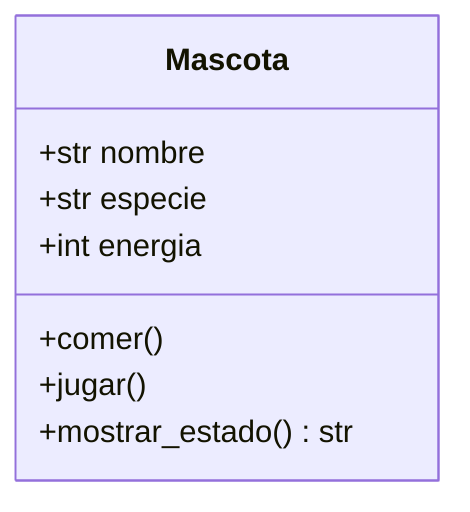
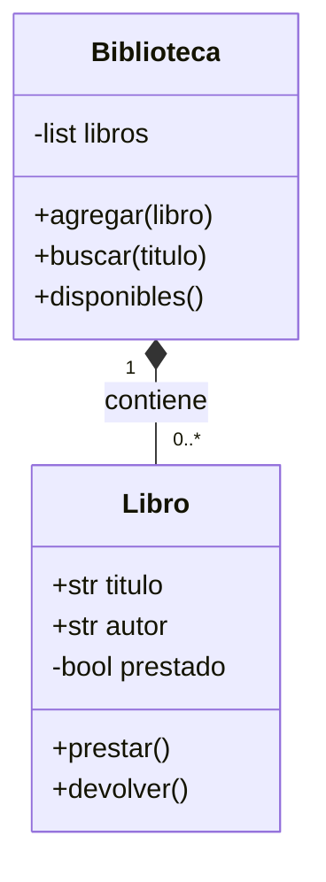
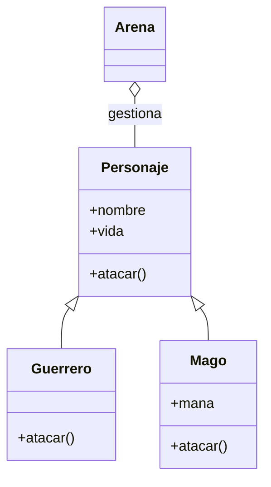

# UT6: Programación orientada a objetos (POO) en Python

## Introducción

Hasta ahora has trabajado con variables, estructuras de control, colecciones,
funciones, módulos, archivos y excepciones. Esas herramientas siguen siendo
válidas: la programación orientada a objetos (POO) las organiza alrededor de
las entidades de un problema. En lugar de mantener diccionarios y funciones
desconectadas, podemos reunir los datos y las operaciones relacionadas en una
clase.

Imagina una aplicación de una biblioteca. Con diccionarios tendríamos que
recordar qué clave contiene el título, qué función comprueba si un libro está
prestado y qué código cambia ese estado. Con objetos, un `Libro` conoce su
título y puede ofrecer la operación `prestar()`. La clase no sustituye a las
funciones ni a los diccionarios: proporciona otra forma de modelar problemas
cuando existen muchas entidades con datos y comportamiento relacionados.

!!! info "Al finalizar la unidad"
    Serás capaz de crear clases con estado válido, proteger sus operaciones con
    validaciones, relacionar objetos mediante composición, reutilizar código
    con herencia cuando tenga sentido, aprovechar el polimorfismo, separar un
    programa en módulos, serializar objetos sencillos y probar sus reglas con
    `unittest`.

### Objetivos

Al terminar deberías poder:

- explicar la diferencia entre clase, objeto, atributo, estado, comportamiento
  y método;
- definir clases e instanciarlas con constructores claros;
- distinguir atributos de instancia y de clase;
- mantener invariantes y lanzar `ValueError` antes de dejar un objeto a medias;
- exponer una interfaz pública mediante propiedades y métodos;
- modelar relaciones de composición e identificar una herencia adecuada;
- recorrer objetos distintos usando una operación común;
- organizar varias clases en módulos sin dependencias circulares;
- probar casos normales y errores, y guardar objetos en JSON mediante
  `to_dict()` y `from_dict()`;
- diseñar un pequeño programa orientado a objetos documentado y mantenible.

## 1. De funciones y diccionarios a objetos

La programación estructurada expresa un algoritmo como instrucciones,
condicionales y bucles. La programación modular separa esas instrucciones en
funciones y módulos reutilizables. La POO añade una forma de agrupar **estado**
y **comportamiento** alrededor de conceptos del problema. Ningún enfoque es
incorrecto: una función corta puede ser la mejor solución y una clase pequeña
puede resultar innecesaria.

### El mismo problema con un diccionario

```python
def crear_personaje(nombre, vida):
    return {"nombre": nombre, "vida": vida}


def recibir_danio(personaje, cantidad):
    if cantidad < 0:
        raise ValueError("El daño no puede ser negativo")
    personaje["vida"] = max(0, personaje["vida"] - cantidad)


heroina = crear_personaje("Aina", 100)
recibir_danio(heroina, 15)
print(heroina["vida"])  # 85
```

Este código puede ser perfectamente adecuado para un programa pequeño. Cuando
aparecen muchos tipos de personaje, muchas operaciones y muchas reglas, es
fácil escribir por error `personaje["vidaa"]`, olvidar una validación o pasar
un diccionario de una forma inesperada.

### El mismo problema con una clase

```python
class Personaje:
    def __init__(self, nombre, vida=100):
        if not nombre.strip():
            raise ValueError("El nombre no puede estar vacío")
        if vida < 0:
            raise ValueError("La vida no puede ser negativa")
        self.nombre = nombre
        self.vida = vida

    def recibir_danio(self, cantidad):
        if cantidad < 0:
            raise ValueError("El daño no puede ser negativo")
        self.vida = max(0, self.vida - cantidad)


heroina = Personaje("Aina")
heroina.recibir_danio(15)
print(heroina.vida)  # 85
```

La clase concentra las reglas de un personaje. Aun así, la elección depende
del problema: no conviertas automáticamente cada dato en una clase.

!!! tip "Pregunta de predicción"
    ¿Qué debe ocurrir si llamamos a `heroina.recibir_danio(-1)`? Una operación
    inválida debe fallar antes de modificar la vida.

## 2. Clase, objeto, atributos y métodos

Una **clase** es un molde o descripción de un tipo de objeto. Un **objeto** (o
**instancia**) es un ejemplar concreto de esa clase. Una instancia tiene:

- **atributos**, que describen sus datos;
- **estado**, que es el conjunto de valores de sus atributos en un momento;
- **comportamiento**, que son las acciones que puede realizar;
- **métodos**, que son funciones definidas dentro de una clase.

La clase `Mascota` puede describir muchas mascotas. `luna` y `toby` serán dos
objetos distintos, cada uno con su propio nombre y energía.



Para empezar basta con la clase principal:

```python
class Mascota:
    def __init__(self, nombre, especie):
        self.nombre = nombre
        self.especie = especie
        self.energia = 50

    def jugar(self):
        self.energia = max(0, self.energia - 20)

    def comer(self):
        self.energia = min(100, self.energia + 15)

    def mostrar_estado(self):
        return f"{self.nombre} ({self.especie}): {self.energia}/100"


luna = Mascota("Luna", "gato")
toby = Mascota("Toby", "perro")
luna.jugar()
print(luna.mostrar_estado())  # Luna (gato): 30/100
print(toby.mostrar_estado())  # Toby (perro): 50/100
```

`luna` y `toby` pertenecen a la misma clase, pero `luna is toby` es falso y
sus estados no se mezclan.

## 3. Crear clases, instanciar y devolver resultados

Una definición comienza con `class`, un nombre en `PascalCase` y dos puntos.
Dentro se escriben atributos iniciales y métodos con nombres en `snake_case`.

```python
class Rectangulo:
    def __init__(self, ancho, alto):
        if ancho <= 0 or alto <= 0:
            raise ValueError("Las dimensiones deben ser positivas")
        self.ancho = ancho
        self.alto = alto

    def area(self):
        return self.ancho * self.alto

    def es_cuadrado(self):
        return self.ancho == self.alto


figura = Rectangulo(4, 3)
print(figura.area())         # 12
print(figura.es_cuadrado())  # False
```

Para construir un objeto escribimos `Clase(argumentos)`. Para acceder a un
atributo o llamar a un método usamos un punto. Un método debe devolver un
resultado cuando otra parte del programa necesita tomar decisiones con él.
Mostrar un valor y devolverlo son acciones distintas:

```python
def area_y_mostrar(rectangulo):
    print(rectangulo.area())  # efecto en pantalla


def area_para_calcular(rectangulo):
    return rectangulo.area()  # dato que puede reutilizarse
```

En una clase suele ser mejor que `area()` devuelva el número y que la interfaz
decida después si debe imprimirlo, guardarlo o compararlo.

## 4. `self` y `__init__`

`self` representa la instancia que está utilizando el método. Python lo pasa
automáticamente cuando escribimos `objeto.metodo()`, pero debemos declararlo
como primer parámetro en la definición.

```python
class Saludo:
    def __init__(self, nombre):
        self.nombre = nombre

    def texto(self):
        return f"Hola, {self.nombre}"


saludo = Saludo("Nora")
print(saludo.texto())
```

En `self.nombre = nombre`, la izquierda es un atributo que queda guardado en
la instancia y la derecha es el parámetro local recibido por `__init__`. Si
escribimos `nombre = nombre`, solo reasignamos el parámetro y el objeto no
conserva el dato.

`__init__` se ejecuta para inicializar una instancia ya creada. No es,
literalmente, el método que crea el objeto; esa creación se relaciona con
`__new__`, que no necesitamos redefinir en esta unidad.

```python
class Contador:
    def __init__(self, inicial=0):
        self.valor = inicial

    def incrementar(self, cantidad=1):
        self.valor += cantidad
        return self.valor


primero = Contador()
segundo = Contador(10)
primero.incrementar()
print(primero.valor)  # 1
print(segundo.valor)  # 10
```

!!! warning "Error frecuente"
    Si Python muestra `TypeError: ... missing 1 required positional argument:
    'self'`, revisa que el método incluya `self` y que lo llames mediante una
    instancia: `contador.incrementar()`.

## 5. Atributos de instancia y de clase

Un atributo creado con `self` pertenece a cada instancia. Un atributo escrito
directamente en el cuerpo de la clase puede representar un dato compartido por
la clase completa.

```python
class Alumno:
    centro = "IES Ejemplo"  # atributo de clase

    def __init__(self, nombre):
        self.nombre = nombre  # atributo de instancia


ana = Alumno("Ana")
bruno = Alumno("Bruno")
print(ana.centro, bruno.centro)
```

La búsqueda `ana.centro` encuentra primero un atributo de la instancia y, si
no existe, busca en la clase. Si asignamos `ana.centro = "Otro centro"`, no
cambiamos el atributo de clase: creamos un atributo propio para `ana`.

### El peligro de las listas mutables compartidas

Este diseño es incorrecto si cada alumno debe tener sus propias notas:

```python
class AlumnoIncorrecto:
    notas = []  # una única lista compartida por todas las instancias
```

La solución es crear la lista en `__init__`:

```python
class Alumno:
    def __init__(self, nombre):
        self.nombre = nombre
        self.notas = []


ana = Alumno("Ana")
bruno = Alumno("Bruno")
ana.notas.append(9)
print(ana.notas)    # [9]
print(bruno.notas)  # []
```

`is` comprueba identidad: si dos nombres apuntan al mismo objeto. `==`
comprueba igualdad de valores, según las reglas del tipo.

```python
uno = Alumno("Ana")
dos = Alumno("Ana")
print(uno is dos)  # False: son instancias diferentes
print(uno == dos)  # False por defecto: no hemos definido igualdad
```

Dos diccionarios con el mismo contenido sí suelen ser `==`; dos instancias de
una clase no son iguales automáticamente solo porque tengan atributos iguales.

## 6. Métodos, reglas e invariantes

Un método puede consultar o modificar el estado. Una **invariante** es una
regla que debe mantenerse siempre, por ejemplo “el saldo nunca es negativo” o
“la energía está entre 0 y 100”. Validar al principio de una operación ayuda a
que un error no deje el objeto en un estado parcial.

```python
class Producto:
    def __init__(self, nombre, precio, stock=0):
        if not nombre.strip():
            raise ValueError("El nombre es obligatorio")
        if precio < 0 or stock < 0:
            raise ValueError("Precio y stock no pueden ser negativos")
        self.nombre = nombre
        self.precio = precio
        self.stock = stock

    def vender(self, cantidad):
        if cantidad <= 0:
            raise ValueError("La cantidad debe ser positiva")
        if cantidad > self.stock:
            raise ValueError("No hay suficiente stock")
        self.stock -= cantidad

    def reponer(self, cantidad):
        if cantidad <= 0:
            raise ValueError("La cantidad debe ser positiva")
        self.stock += cantidad

    def valor_inventario(self):
        return self.precio * self.stock
```

Observa el orden de `vender()`: primero comprueba todas las condiciones y solo
después modifica `stock`. Si una venta falla, el valor anterior permanece.

!!! note "`return` frente a `print`"
    Las reglas del dominio deben devolver datos o lanzar excepciones. La capa
    de interfaz puede imprimir esos datos. Así resulta sencillo probar la clase
    sin depender de la pantalla.

## 7. Encapsulación y propiedades

La encapsulación consiste en ofrecer una interfaz estable y limitar el acceso
directo a los detalles que no deberían manipularse sin reglas. Python no aplica
privacidad estricta: `_saldo` es una convención que indica “uso interno”, no
una barrera absoluta.

Una propiedad permite consultar un valor mediante una expresión sencilla y
controlar cómo se obtiene o modifica.

```python
class CuentaBancaria:
    def __init__(self, titular, saldo_inicial=0):
        if not titular.strip() or saldo_inicial < 0:
            raise ValueError("Titular o saldo no válidos")
        self.titular = titular
        self._saldo = saldo_inicial

    @property
    def saldo(self):
        """Saldo de solo lectura para el resto del programa."""
        return self._saldo

    def ingresar(self, cantidad):
        if cantidad <= 0:
            raise ValueError("La cantidad debe ser positiva")
        self._saldo += cantidad

    def retirar(self, cantidad):
        if cantidad <= 0 or cantidad > self._saldo:
            raise ValueError("Retirada no válida")
        self._saldo -= cantidad
```

`cuenta.saldo` se puede leer, pero `cuenta.saldo = -10` falla porque no hemos
definido un setter. No conviene crear getters y setters triviales para todos
los atributos: si no hay una regla que proteger, un atributo público puede ser
más claro.

## 8. `__str__` y `__repr__`

`str(objeto)` y `print(objeto)` utilizan `__str__` cuando la clase lo define.
Debe ofrecer una representación breve y comprensible para una persona.
`repr(objeto)` se orienta más a depuración y a mostrar información inequívoca.

```python
class Libro:
    def __init__(self, titulo, autor):
        self.titulo = titulo
        self.autor = autor

    def __str__(self):
        return f"{self.titulo}, de {self.autor}"

    def __repr__(self):
        return f"Libro(titulo={self.titulo!r}, autor={self.autor!r})"


libro = Libro("La plaza", "Irene")
print(libro)       # La plaza, de Irene
print(repr(libro)) # Libro(titulo='La plaza', autor='Irene')
```

## 9. Relaciones entre objetos y composición

La **composición** representa una relación “tiene un”: una `Biblioteca` tiene
libros, un `Equipo` tiene jugadores. La responsabilidad se reparte: el libro
conoce su estado de préstamo y la biblioteca gestiona la colección.



```python
class Biblioteca:
    def __init__(self):
        self._libros = []

    def agregar(self, libro):
        self._libros.append(libro)

    def buscar(self, titulo):
        buscado = titulo.casefold()
        return [libro for libro in self._libros
                if buscado in libro.titulo.casefold()]

    def disponibles(self):
        return [libro for libro in self._libros if not libro.prestado]
```

No confundas “tiene un” con “es un”. Un `Mago` **es un** `Personaje`, por lo
que podría tener sentido la herencia. Una `Arena` **tiene** personajes, por lo
que normalmente usaremos composición.

## 10. Herencia, `super()` y sobrescritura

La herencia permite crear una clase derivada a partir de una clase base. La
clase derivada reutiliza lo común y puede añadir o sobrescribir comportamiento.



```python
class Personaje:
    def __init__(self, nombre, vida=100):
        if not nombre.strip() or vida <= 0:
            raise ValueError("Datos de personaje no válidos")
        self.nombre = nombre
        self.vida = vida

    def esta_vivo(self):
        return self.vida > 0

    def atacar(self):
        return 6


class Guerrero(Personaje):
    def __init__(self, nombre):
        super().__init__(nombre, vida=120)

    def atacar(self):
        return 14
```

`super().__init__` llama al inicializador de la clase base. No copies código
común sin motivo. Sobrescribir significa definir en la derivada un método con
el mismo nombre para ofrecer una versión especializada.

No conviene heredar solo para compartir unas líneas: si la relación “es un” no
es natural, usa composición o una función. La herencia introduce dependencia
entre clases y debe hacer el modelo más claro, no más complicado.

## 11. Polimorfismo y duck typing

El polimorfismo permite pedir la misma operación a objetos distintos y dejar
que cada uno responda según su tipo.

```python
class Mago(Personaje):
    def __init__(self, nombre):
        super().__init__(nombre, vida=80)
        self.mana = 9

    def atacar(self):
        if self.mana >= 3:
            self.mana -= 3
            return 18
        return 4


personajes = [Guerrero("Ada"), Mago("Leo"), Personaje("Nora")]
for personaje in personajes:
    print(personaje.nombre, personaje.atacar())
```

No necesitamos una cadena de `if type(personaje) is ...`. Cada objeto cumple el
contrato de ofrecer `atacar()`.

Python no tiene sobrecarga de métodos como Java basada en varias firmas. Si
defines dos métodos con el mismo nombre, el segundo reemplaza al primero.
Puedes usar valores por defecto, argumentos variables o métodos con nombres
distintos cuando proceda. Además, Python admite **duck typing**: una función
puede aceptar cualquier objeto que tenga el método que necesita.

```python
def anunciar_ataque(personaje):
    # No importa la clase exacta; basta con que tenga atacar() y nombre.
    return f"{personaje.nombre} causa {personaje.atacar()} puntos"
```

## 12. Métodos de clase y estáticos

Un método de instancia recibe `self`. Un `@classmethod` recibe `cls` y puede
crear instancias alternativas o trabajar con datos compartidos por la clase.
Un `@staticmethod` no recibe automáticamente ni `self` ni `cls`; es una función
relacionada conceptualmente con la clase.

```python
class EntradaConcierto:
    siguiente_id = 1

    def __init__(self, concierto, precio):
        if not self.precio_valido(precio):
            raise ValueError("Precio no válido")
        self.id = EntradaConcierto.siguiente_id
        EntradaConcierto.siguiente_id += 1
        self.concierto = concierto
        self.precio = precio

    @staticmethod
    def precio_valido(precio):
        return isinstance(precio, (int, float)) \
            and not isinstance(precio, bool) and precio >= 0

    @classmethod
    def desde_texto(cls, texto):
        try:
            concierto, precio = texto.split(";", maxsplit=1)
            return cls(concierto.strip(), float(precio))
        except (ValueError, TypeError) as error:
            raise ValueError("Formato esperado: Concierto;29.50") from error

    def __str__(self):
        return f"#{self.id}: {self.concierto} ({self.precio:.2f} €)"
```

Usa un método estático si la operación pertenece al vocabulario de la clase
pero no necesita el estado de una instancia. Si no existe esa relación, una
función normal en un módulo suele ser más sencilla.

## 13. Módulos y organización del proyecto

Cuando una clase crece, colócala en un módulo con un nombre descriptivo. Una
organización sencilla puede ser:

```text
arena_heroes/
├── personaje.py
├── guerrero.py
├── mago.py
├── combate.py
├── arena.py
└── main.py
```

Un módulo importa las clases que utiliza:

```python
# guerrero.py
from personaje import Personaje


class Guerrero(Personaje):
    pass
```

El archivo principal se ocupa de la entrada y salida, no de todas las reglas
del dominio:

```python
# main.py
from guerrero import Guerrero


def ejecutar():
    guerrero = Guerrero("Ada")
    print(guerrero.nombre)


if __name__ == "__main__":
    ejecutar()
```

La condición evita que el menú se ejecute al importar `main` desde una prueba.
Evita dependencias circulares: si `personaje.py` importa `mago.py` y `mago.py`
importa `personaje.py`, reorganiza las responsabilidades o importa dentro de
una función solo cuando sea una solución justificada.

## 14. Excepciones, validación y pruebas

Las excepciones comunican que una operación no es válida. El constructor debe
rechazar datos imposibles y los métodos deben validar antes de modificar el
estado.

```python
class Termometro:
    def __init__(self, grados):
        self._grados = self._validar(grados)

    @staticmethod
    def _validar(grados):
        if not isinstance(grados, (int, float)):
            raise TypeError("Los grados deben ser numéricos")
        if grados < -273.15:
            raise ValueError("No se puede bajar del cero absoluto")
        return grados

    def cambiar(self, grados):
        nuevo = self._validar(grados)
        self._grados = nuevo

    @property
    def grados(self):
        return self._grados
```

El patrón `nuevo = validar(...); self._dato = nuevo` garantiza que un error no
deje una parte del objeto actualizada y otra sin actualizar.

### Pruebas con `unittest`

```python
import unittest


class TestTermometro(unittest.TestCase):
    def test_cambiar_guarda_el_valor(self):
        termometro = Termometro(20)
        termometro.cambiar(21.5)
        self.assertEqual(termometro.grados, 21.5)

    def test_rechaza_cero_absoluto(self):
        with self.assertRaises(ValueError):
            Termometro(-300)


if __name__ == "__main__":
    unittest.main()
```

Prueba al menos un caso normal, un límite y cada error importante. Una prueba
no solo comprueba que “funciona”: documenta qué comportamiento debe conservarse
cuando el programa evolucione.

## 15. Integración con JSON

JSON solo conoce objetos básicos como diccionarios, listas, cadenas y números.
No guarda automáticamente una instancia de Python ni sus métodos. Una clase
puede definir `to_dict()` para serializar datos y `from_dict()` para reconstruir
una instancia.

```python
import json


class Nota:
    def __init__(self, texto, importante=False):
        if not texto.strip():
            raise ValueError("La nota no puede estar vacía")
        self.texto = texto
        self.importante = importante

    def to_dict(self):
        return {"texto": self.texto, "importante": self.importante}

    @classmethod
    def from_dict(cls, datos):
        return cls(datos["texto"], datos.get("importante", False))


nota = Nota("Repasar POO", True)
texto_json = json.dumps(nota.to_dict(), ensure_ascii=False)
datos = json.loads(texto_json)
reconstruida = Nota.from_dict(datos)
print(reconstruida.texto)
```

En una lista de objetos, guarda una lista de diccionarios. Al cargarla,
recorre los diccionarios y llama a `from_dict()` para recuperar el tipo y sus
reglas. Si el archivo no existe o contiene JSON mal formado, decide si debes
capturar `FileNotFoundError`/`json.JSONDecodeError` en la interfaz o propagar
una excepción de dominio.

## 16. Buenas prácticas y errores habituales

Un diseño POO claro suele tener nombres expresivos, métodos cortos y una única
responsabilidad principal por clase. Antes de crear una clase, pregunta qué
estado debe proteger, qué acciones le pertenecen y qué colaboración necesita.

Errores que conviene detectar:

| Error | Mejora |
|---|---|
| Omitir `self` | Añadirlo como primer parámetro de cada método de instancia. |
| Escribir `nombre = nombre` | Guardar la entrada como `self.nombre = nombre`. |
| Definir `lista = []` en la clase | Crear `self.lista = []` en `__init__`. |
| Usar `print()` donde se necesita un dato | Devolver con `return` y mostrar en la interfaz. |
| Confiar en que `_dato` es privado | Recordar que es una convención y proteger invariantes en métodos. |
| Heredar para cualquier reutilización | Elegir composición si la relación “es un” no es real. |
| Comprobar `type()` con muchos `if` | Diseñar una operación común y usar polimorfismo. |
| Cambiar el estado antes de validar | Validar primero y modificar después. |
| Crear una clase para un dato trivial | Mantener una función o un tipo simple si resulta más claro. |

### Checklist de autoevaluación

- [ ] Puedo explicar clase, instancia, atributo y método con un ejemplo.
- [ ] Sé por qué `self.nombre = nombre` guarda el dato.
- [ ] Mis listas y diccionarios pertenecen a la instancia correcta.
- [ ] Mis métodos devuelven resultados y no mezclan reglas con la interfaz.
- [ ] Las operaciones inválidas lanzan una excepción sin corromper el estado.
- [ ] Distingo composición (“tiene un”) de herencia (“es un”).
- [ ] Puedo recorrer una lista polimórfica sin inspeccionar tipos.
- [ ] Sé separar clases en módulos y proteger el punto de entrada.
- [ ] Tengo pruebas de casos normales, límites y errores.
- [ ] Puedo convertir objetos a diccionarios y reconstruirlos desde JSON.

Practica la progresión en [los ejercicios de clase de POO](ejercicios_poo_clase.md)
y aplica el diseño completo en el [proyecto Arena de héroes](proyecto_poo.md).
