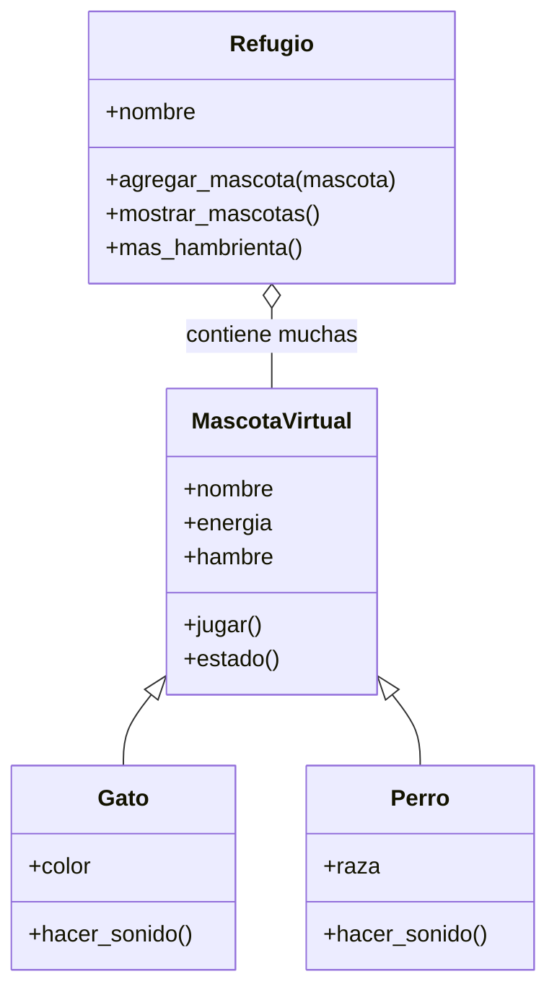

# Práctica: Tamagotchi Evolution — El refugio de mascotas (parte 2)

## 1. Contexto y objetivo

El pequeño refugio **Patitas Felices** necesita una aplicación de consola para
cuidar a sus mascotas virtuales. En la primera parte construiste una mascota
con energía y hambre; ahora vas a convertirla en un modelo más completo, con
especies especializadas y un refugio capaz de gestionarlas.

El objetivo es practicar, paso a paso, **encapsulación, propiedades, herencia,
`super()`, sobrescritura, composición, polimorfismo, `__str__()` y organización
en módulos**. Será un programa pequeño y comprobable: no necesitas interfaz
gráfica, base de datos, persistencia, librerías externas ni un menú extenso.
Usa Python 3 y la biblioteca estándar.

## 2. Conocimientos previos y punto de partida

Se supone que ya sabes crear clases y objetos, escribir un constructor
`__init__`, definir métodos, usar listas y separar un programa en varios
archivos. También debes haber visto validaciones, propiedades, herencia,
`super()`, composición y polimorfismo en la teoría de esta unidad.

Esta práctica continúa una primera parte concreta. Debes partir de una clase
`MascotaVirtual` que cumpla este contrato; aquí se muestra la especificación,
no su implementación:

- `MascotaVirtual(nombre)` recibe el nombre.
- Al crearla, `nombre` toma el valor recibido, `energia` vale `60` y `hambre`
  vale `30`.
- `presentarse()` devuelve una frase que contiene el nombre.
- `jugar()` gasta `20` puntos de energía y aumenta `15` puntos de hambre.
- `comer()` reduce `20` puntos de hambre.
- `descansar()` aumenta `25` puntos de energía.
- Energía y hambre se mantienen siempre entre `0` y `100`.
- En la primera parte no se puede jugar con menos de `20` puntos de energía. Si
  el intento no es posible, el estado no cambia. En esta segunda parte la
  regla se adapta al coste de juego de cada especie: se comprueba que haya
  energía suficiente para pagar ese coste.

Este contrato **no coincide** con el ejercicio existente «1. Mascota virtual»:
ese ejercicio usa la clase `Mascota`, una especie y energía inicial `50`. No lo
uses como si fuera la primera parte de este proyecto. Si todavía no has creado
`MascotaVirtual`, constrúyela con la especificación anterior antes de comenzar.

## 3. Duración orientativa

La práctica está pensada para **2-3 sesiones de 50 minutos**. Puedes guardar
una copia funcional al terminar cada fase y anotar las decisiones que tomes.

## 4. Fases de trabajo

### Fase 1 — Encapsulación y propiedades (20 minutos)

**Objetivo:** proteger el estado interno de una mascota y conservar sus
límites.

**Tareas**

1. Cambia los datos internos a `_energia` y `_hambre`.
2. Expón `energia` y `hambre` mediante propiedades de solo lectura usando
   `@property`.
3. Haz que `jugar()`, `comer()` y `descansar()` sean las operaciones que
   modifican esos valores.
4. Conserva siempre los límites `0 <= energia <= 100` y
   `0 <= hambre <= 100`. Un aumento que superaría `100` debe quedarse en `100`
   y una reducción que bajaría de `0` debe quedarse en `0`.

**Restricciones**

- Durante esta fase no hace falta implementar *setters*.
- No conviertas `_energia` y `_hambre` en una promesa de privacidad estricta:
  el guion bajo es una convención de uso interno de Python.
- El código exterior debe utilizar la interfaz pública, no modificar los
  atributos internos directamente.

**Comprobaciones**

- Crea una mascota con energía o hambre cerca de cada límite y verifica que
  ninguna operación deja un valor menor que `0` o mayor que `100`.
- Ejecuta `mascota.energia = -500`. La propiedad de solo lectura no debe
  permitir esa asignación; comprueba la excepción que produce Python y
  confirma que el estado no ha cambiado.
- Comprueba que `mascota._energia` puede ser accesible porque el guion bajo no
  es privacidad real, pero documenta que no forma parte de la interfaz pública.

### Fase 2 — Herencia y sobrescritura (30-40 minutos)

**Objetivo:** añadir especies con comportamientos propios sin copiar toda la
clase base.

Crea dos subclases de `MascotaVirtual`:

| Clase | Constructor | Atributo exclusivo | `hacer_sonido()` | `jugar()` |
|---|---|---|---|---|
| `Gato` | `Gato(nombre, color)` | `color` | devuelve `"Miau"` | gasta 10 de energía y suma 10 de hambre |
| `Perro` | `Perro(nombre, raza)` | `raza` | devuelve `"Guau"` | gasta 25 de energía y suma 20 de hambre |

**Tareas y restricciones**

- Añade `hacer_sonido()` a `MascotaVirtual`, devolviendo `"..."`, y
  sobrescríbelo en `Gato` y `Perro`.
- Usa `super().__init__(nombre)` en los constructores de las dos subclases.
- Sobrescribe `jugar()` manteniendo los límites de energía y hambre.
- Comprueba la energía necesaria para el coste de la especie: `10` para un
  gato y `25` para un perro. Si no es suficiente, no se juega y no se modifica
  ni la energía ni el hambre. Esta regla sustituye, para cada subclase, el
  umbral general de `20` de la primera parte.
- Puedes extraer un método auxiliar en la clase base para reutilizar una
  validación, pero no es obligatorio aplicar técnicas que no se hayan visto.

**Ejemplo de uso (sin soluciones)**

```python
gato = Gato("Misifu", "Negro")
perro = Perro("Rex", "Labrador")

gato.jugar()
perro.jugar()

print(gato.energia)          # 50
print(perro.energia)         # 35
print(gato.hacer_sonido())   # Miau
print(perro.hacer_sonido())  # Guau
```

**Comprobaciones**

- Prepara un gato con `5` puntos de energía y un perro con `20` y comprueba
  que cada intento falla de forma controlada.
- Después de cada intento fallido, verifica que el hambre conserva exactamente
  su valor anterior.
- Comprueba que los atributos exclusivos `color` y `raza` se guardan en el
  objeto correcto.

### Fase 3 — Refugio y composición (30 minutos)

**Objetivo:** crear una clase que contiene y gestiona objetos de otra clase.

Crea `Refugio` con el siguiente contrato:

- `Refugio(nombre)` guarda el nombre y crea en `__init__` una lista propia de
  mascotas, por ejemplo `_mascotas`.
- `agregar_mascota(mascota)` incorpora una `MascotaVirtual` o una instancia de
  una subclase. No debe añadir dos veces el mismo objeto.
- `cantidad_mascotas()` devuelve un entero.
- `mostrar_mascotas()` devuelve una lista de cadenas con el estado de cada
  mascota. La presentación en pantalla se hace desde `main.py`, que recorre e
  imprime esas cadenas. La lógica de `Refugio` no utiliza `input()` ni `print()`.
- `mas_hambrienta()` devuelve el objeto con mayor hambre. Si el refugio está
  vacío devuelve `None`; si hay empate, devuelve la primera mascota añadida de
  entre las empatadas.

**Restricciones y comprobaciones**

- Un único contenedor debe admitir gatos, perros y mascotas base. No crees una
  lista distinta para cada especie.
- Un refugio recién creado tiene `0` mascotas.
- Crea dos refugios nuevos y comprueba que sus listas son independientes.
  Añadir una mascota a uno no puede cambiar la cantidad del otro.
- Añade varias mascotas y verifica que `mas_hambrienta()` devuelve el objeto
  correcto. Comprueba también que un refugio vacío devuelve `None`.

El modelo puede resumirse así:



`Gato` y `Perro` **son** mascotas virtuales: eso es herencia. `Refugio`
**tiene** mascotas virtuales: eso es composición.

### Fase 4 — Polimorfismo (20 minutos)

**Objetivo:** ejecutar la misma operación sobre objetos que tienen
comportamientos diferentes.

Añade a `Refugio` el método `hora_de_jugar()`. Debe recorrer la colección y
llamar a `jugar()` de cada mascota. Cada clase decide cuánto consume: el
refugio no necesita conocer el coste del gato ni el del perro.

**Restricciones**

- Dentro de la lógica de juego no uses `type()`, `isinstance()` ni
  condicionales para distinguir especies.
- Si una mascota no tiene energía suficiente, su intento se omite sin impedir
  que las demás mascotas jueguen.
- Una posible validación de tipos al añadir una mascota es una decisión
  distinta; no la confundas con la lógica polimórfica de `hora_de_jugar()`.

**Comprobaciones**

- Coloca en el mismo refugio una mascota base, un gato y un perro.
- Ejecuta una sola `hora_de_jugar()` y comprueba que cada coste se aplica sin
  cambiar el código de `Refugio`.
- Incluye una mascota sin energía suficiente y comprueba que las demás sí
  ejecutan su acción.
- Escribe una explicación breve: un solo bucle funciona porque todos los
  objetos ofrecen `jugar()`, aunque cada clase resuelva ese método de manera
  distinta.

### Fase 5 — `__str__` y organización por módulos (20-30 minutos)

**Objetivo:** hacer el programa legible y separar responsabilidades.

Añade `__str__()` a `MascotaVirtual` para que `print(mascota)` produzca un
resumen legible con nombre, energía y hambre. Organiza el código con esta
estructura:

```text
tamagotchi/
├── mascota.py
├── gato.py
├── perro.py
├── refugio.py
└── main.py
```

Adapta los nombres solo si una convención del repositorio o de tu entorno lo
exige. `main.py` debe:

1. construir un refugio;
2. añadir al menos cuatro mascotas de al menos dos especies;
3. mostrar el estado inicial;
4. ejecutar `hora_de_jugar()`;
5. mostrar el estado final.

Explica las importaciones entre archivos y utiliza, si lo deseas, un bloque
`if __name__ == "__main__":` para iniciar la demostración solo al ejecutar
`main.py`. No conviertas la práctica en una lección de empaquetado: basta con
que se entienda qué módulo define cada clase.

Mantén las reglas del dominio dentro de las clases. `main.py` coordina la
demostración y muestra resultados, pero no decide cuánto hambre o energía
consume cada especie.

## 5. Ejemplo final verificable

El siguiente fragmento muestra el uso esperado de las clases. Es un ejemplo de
interfaz, **no una implementación de las clases**:

```python
refugio = Refugio("Patitas Felices")
refugio.agregar_mascota(Gato("Misifu", "Negro"))
refugio.agregar_mascota(Perro("Rex", "Labrador"))
refugio.agregar_mascota(Gato("Luna", "Blanco"))

refugio.hora_de_jugar()

for estado in refugio.mostrar_mascotas():
    print(estado)
```

Con los valores iniciales fijados, la salida esperada —aunque el formato de
texto puede ser distinto— contiene:

```text
Misifu | Energía: 50 | Hambre: 40
Rex    | Energía: 35 | Hambre: 50
Luna   | Energía: 50 | Hambre: 40
```

La comprobación numérica es: un gato parte de `60/30` y queda en `50/40`; un
perro parte de `60/30` y queda en `35/50`.

## 6. Relación entre fases y conceptos de POO

| Fase | Conceptos que debes demostrar |
|---|---|
| 1. Encapsulación | Atributos internos, `@property`, invariantes y métodos de modificación |
| 2. Especies | Herencia, `super()`, sobrescritura y atributos específicos |
| 3. Refugio | Composición, listas de instancias e independencia de objetos |
| 4. Juego | Polimorfismo y una interfaz común sin inspeccionar tipos |
| 5. Módulos | `__str__()`, importaciones, responsabilidades y punto de entrada |

## 7. Entrega y autocorrección

Entrega una carpeta `tamagotchi/` con los cinco archivos `.py` indicados.
`main.py` debe poder ejecutarse y demostrar al menos cuatro mascotas de dos
especies. Añade evidencias de prueba, mediante salidas o `assert` propios, que
incluyan límites, independencia de objetos, una mascota sin energía
suficiente, refugio vacío y comportamiento polimórfico.

Incluye también una explicación de 4-6 líneas sobre la diferencia entre
**herencia** (`Gato` es `MascotaVirtual`) y **composición** (`Refugio` tiene
mascotas), y sobre por qué `hora_de_jugar()` es polimórfico.

### Checklist de autocorrección

- [ ] `MascotaVirtual(nombre)` empieza con energía `60` y hambre `30`.
- [ ] `presentarse()`, `comer()`, `descansar()`, `jugar()` y `estado()` tienen
      el contrato indicado.
- [ ] `_energia` y `_hambre` están protegidos mediante propiedades de solo
      lectura y los valores permanecen entre `0` y `100`.
- [ ] Intentar asignar `mascota.energia` desde fuera no permite saltarse las
      reglas.
- [ ] `Gato` y `Perro` usan `super().__init__(nombre)` y conservan sus datos
      exclusivos.
- [ ] Los sonidos, costes y aumentos de hambre de las especies son correctos.
- [ ] Un juego fallido no modifica ni energía ni hambre.
- [ ] Cada `Refugio` crea su propia lista y no duplica el mismo objeto.
- [ ] `mostrar_mascotas()` devuelve una lista de cadenas y
      `mas_hambrienta()` devuelve un objeto o `None` según corresponda.
- [ ] `hora_de_jugar()` usa una sola operación común y no discrimina especies
      con `type()` o `isinstance()`.
- [ ] `__str__()` ofrece un resumen legible y los cinco módulos se pueden
      importar y ejecutar.
- [ ] Las pruebas incluyen refugio vacío, empate de hambre, límites y cuatro
      mascotas de dos especies.

## Reto opcional: incorporar `Conejo`

Crea `Conejo(MascotaVirtual)` con constructor, sonido y un coste de juego
propio y coherente. Elige los valores, documéntalos y respétalos en las
pruebas. Incorpóralo al refugio **sin modificar ninguna línea de `Refugio`**.
Si tu polimorfismo está bien diseñado, el mismo `hora_de_jugar()` debe servir
para gatos, perros y conejos.

## Preguntas de reflexión

1. ¿Por qué es preferible utilizar métodos en vez de modificar `_energia`
   directamente?
2. ¿Por qué `Gato` hereda de `MascotaVirtual` pero `Refugio` no?
3. ¿Por qué un mismo `hora_de_jugar()` sirve para perros, gatos y conejos?
4. ¿Qué ocurriría si `_mascotas = []` fuera un atributo mutable de clase
   compartido por todos los refugios?
