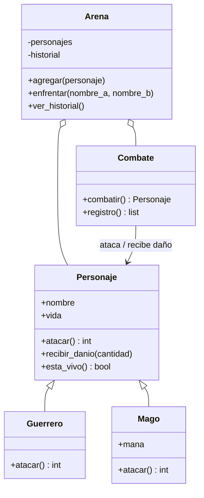

# Proyecto UT6: Arena de héroes — torneo por turnos

## 1. Contexto y reto

Vas a construir un videojuego de consola en el que guerreros y magos se
enfrentan en combates por turnos. El objetivo no es crear una interfaz gráfica
ni utilizar azar: es diseñar un pequeño dominio de objetos con reglas claras,
validaciones, composición, herencia, polimorfismo y pruebas reproducibles.

El programa debe poder ejecutarse sin paquetes de terceros. Las reglas del
combate deben funcionar sin `input()` para poder probarlas automáticamente; el
menú será una capa separada que traduce las opciones del usuario en llamadas a
las clases.

## 2. Objetivos

Al entregar deberás demostrar que sabes:

- crear una jerarquía sencilla con una clase base y dos especializaciones;
- proteger estado y rechazar operaciones inválidas;
- separar el cálculo del daño de la aplicación al oponente;
- coordinar objetos mediante `Combate` y `Arena`;
- recorrer personajes polimórficamente;
- diseñar una interfaz de consola que no contenga las reglas del dominio;
- escribir pruebas y documentación de ejecución.

## 3. Modelo obligatorio

### `Personaje`

- `nombre` no puede estar vacío;
- vida máxima inicial: 100;
- `atacar()` devuelve 6 de daño;
- `recibir_danio(cantidad)` reduce la vida, sin bajar de 0;
- `esta_vivo()` devuelve un booleano;
- no se puede atacar estando derrotado;
- se rechazan daños negativos y cantidades no válidas.

### `Guerrero`

Hereda de `Personaje`, comienza con vida 120 y `atacar()` devuelve 14.

### `Mago`

Hereda de `Personaje`, comienza con vida 80 y maná 9. Un ataque mágico consume
3 manás y devuelve 18 de daño. Si no quedan al menos 3 manás, realiza un ataque
básico de 4 sin consumir maná. Por tanto, la secuencia de cuatro ataques de un
mago nuevo es `18, 18, 18, 4` y su maná final es 0.

### `Combate`

Recibe dos objetos distintos, alterna ataques de forma determinista y termina
cuando uno pierde toda la vida. El atacante obtiene el daño llamando a
`atacar()` y el combate lo aplica al rival mediante `recibir_danio()`.

Debe generar un registro legible y devolver el vencedor. Un combate terminado
no puede ejecutarse una segunda vez. Si un atacante queda derrotado, no puede
realizar otro ataque.

### `Arena`

Mantiene una colección propia de personajes, no diccionarios, y rechaza
nombres duplicados. Debe permitir:

- crear o añadir personajes;
- listarlos;
- enfrentar dos personajes distintos;
- consultar un historial de vencedores y perdedores.

Dos arenas independientes no comparten listas ni historial. Documenta qué
sucede con personajes heridos que ya participaron: la opción recomendada es
crear personajes nuevos para cada combate o rechazar combatientes derrotados;
elige una política, impleméntala y haz que las pruebas coincidan con ella.

!!! warning "Sin azar en los requisitos mínimos"
    No uses aleatoriedad para determinar ataques, turnos o daños. Así cualquier
    persona puede reproducir tus resultados y tus pruebas pueden comprobarlos.

## 4. Diagrama de clases

Amplía o adapta este diagrama si tu diseño lo necesita, pero conserva las
responsabilidades principales:



## 5. Interfaz mínima

El programa debe ofrecer como mínimo este menú:

```text
=== ARENA DE HÉROES ===
1. Crear guerrero
2. Crear mago
3. Mostrar personajes
4. Iniciar combate
5. Ver historial
0. Salir
```

Gestiona errores de entrada con mensajes comprensibles y permite volver al
menú sin terminar abruptamente. El menú puede solicitar nombres, pero las
clases deben ser utilizables desde pruebas sin simular `input()`.

## 6. Fases de desarrollo

### Fase 1 — Modelo y pruebas pequeñas

1. Escribe el diagrama y decide qué atributos son públicos o internos.
2. Implementa `Personaje`, sus validaciones y pruebas.
3. Implementa `Guerrero` y `Mago`, comprobando vida, daño y maná.

### Fase 2 — Combate

1. Define quién comienza y documenta el orden.
2. Alterna turnos hasta que un personaje quede derrotado.
3. Guarda mensajes de registro sin imprimirlos obligatoriamente.
4. Impide ejecutar dos veces el mismo combate.

### Fase 3 — Arena y menú

1. Añade la colección privada o protegida de la arena.
2. Rechaza nombres repetidos y enfrentamientos consigo mismo.
3. Añade historial de ganador y perdedor.
4. Conecta el menú en `main.py` sin trasladar allí las reglas.

### Fase 4 — Calidad y entrega

1. Ejecuta todas las pruebas con `python -m unittest`.
2. Prueba manualmente el menú, incluidos datos inválidos.
3. Revisa nombres, módulos, docstrings y README.
4. Comprueba que otra persona puede ejecutar el proyecto desde cero.

## 7. Pruebas de aceptación

Publica pruebas automáticas o reproducibles que demuestren:

1. Un guerrero nuevo tiene vida 120 y ataque 14.
2. Un mago nuevo tiene vida 80 y maná 9.
3. Cuatro ataques del mago producen 18, 18, 18, 4 y dejan maná 0.
4. Recibir 500 puntos de daño deja la vida en 0.
5. Un personaje derrotado que intenta atacar provoca una excepción controlada.
6. Dos personajes con el mismo nombre son rechazados por una arena.
7. Un personaje no puede enfrentarse a sí mismo.
8. El mismo combate no puede ejecutarse dos veces.
9. Dos arenas no comparten sus colecciones.
10. Un combate terminado devuelve vencedor y deja registro en el historial.

Incluye además validación de nombre vacío, daño negativo, intento de golpe
después de la derrota y comprobación del orden determinista del registro.

## 8. Estructura propuesta

```text
arena_heroes/
├── personaje.py
├── guerrero.py
├── mago.py
├── combate.py
├── arena.py
├── main.py
├── tests/
│   └── test_arena.py
└── README.md
```

Puedes organizar los tests de otra forma si mantienes las responsabilidades y
la ejecución documentada. No utilices bibliotecas externas.

## 9. Ampliaciones opcionales

Cuando los requisitos mínimos y sus pruebas estén terminados, puedes añadir:

- `Arquero` con una regla de ataque diferente;
- pociones e inventario;
- torneo y ranking;
- historial en JSON;
- modo de demostración sin introducir datos.

Estas ampliaciones son posteriores y no deben cambiar silenciosamente las
cifras ni las reglas obligatorias. Documenta cualquier nueva decisión.

## 10. Entrega

Entrega:

- código fuente de todas las clases y el menú;
- `README.md` con requisitos, ejecución, decisiones y ejemplos;
- diagrama sencillo de clases;
- tests de aceptación y casos adicionales;
- una breve explicación de qué parte corresponde a herencia, composición y
  polimorfismo.

### Rúbrica orientativa

| Dimensión | Peso |
|---|---:|
| Clases, constructores, estado y validaciones | 25 % |
| Herencia, sobrescritura y polimorfismo | 20 % |
| Composición y reparto de responsabilidades | 20 % |
| Combate, menú e historial | 20 % |
| Pruebas, documentación y legibilidad | 15 % |

La rúbrica es una propuesta de trabajo y puede ajustarse a la programación del
módulo. Una solución con más funciones, pero con reglas inconsistentes o sin
pruebas, no supera una solución sencilla y fiable.

## 11. Preguntas de diseño

Responde en tu README:

1. ¿Por qué `atacar()` devuelve daño en vez de restarlo directamente?
2. ¿Qué código pertenece a `Personaje` y qué código solo a `Mago`?
3. ¿Por qué `Arena` usa composición en lugar de heredar de `Personaje`?
4. ¿Cómo garantizas que dos arenas no comparten listas por accidente?
5. ¿Qué estado conserva un combate terminado y cómo impides repetirlo?
6. ¿Qué cambiarías para añadir una nueva clase de héroe sin modificar el menú?

Consulta la [teoría de POO](index.md) y los [ejercicios progresivos](ejercicios_poo_clase.md)
si necesitas repasar una técnica antes de implementarla.
